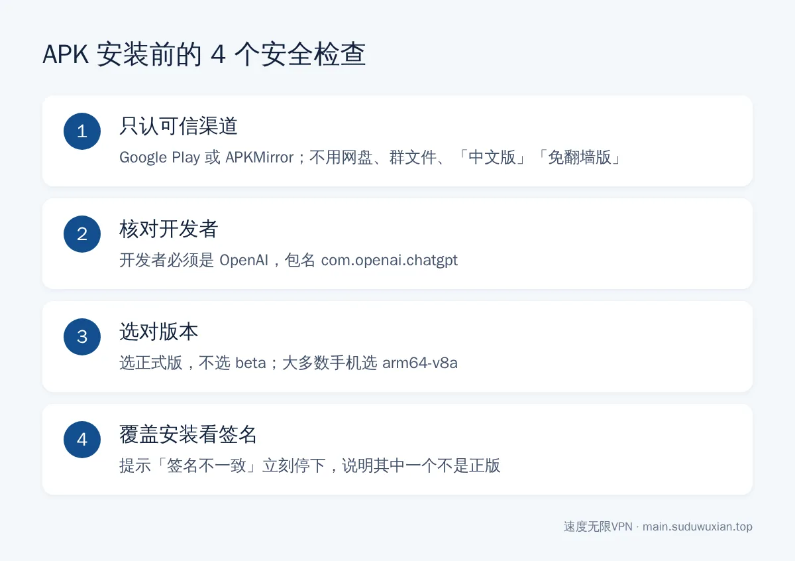

# 国内安卓手机怎么安装 ChatGPT？Google Play 和 APK 两种方法（2026）
<!-- description: 国内安卓手机安装 ChatGPT：有谷歌服务用 Google Play，没有就从 APKMirror 装 OpenAI 官方签名 APK，附 Play 切换国家限制、分应用代理和登录问题排查。 -->

作者：速度无限技术团队 ｜ 最后更新：2026-10-24

**简短回答**：国内安卓手机的自带应用商店里没有 ChatGPT。有谷歌服务的手机，开代理后在 Google Play 搜索安装（开发者认准 OpenAI）；没有谷歌服务、或 Play 提示地区不可用的，从 APKMirror 下载 OpenAI 官方签名的 APK 安装。节点用美国、日本、新加坡等，不要用香港；鸿蒙 NEXT 不能装 APK，只能用网页版。

## 本文要点

- **先看有没有谷歌服务（GMS）**：小米、OPPO、vivo、荣耀等大多能开启；华为 2019 年以后的机型基本没有；鸿蒙 NEXT（纯血鸿蒙）不能安装安卓 APK。
- **方法一 · Google Play**：最正规，能自动更新；Play 的国家/地区是中国时搜不到，切换国家有"每年一次"等限制。
- **方法二 · APK**：不需要谷歌服务，只从可信渠道下载，核对开发者和签名。
- **登录**：没有谷歌服务时"用 Google 登录"可能用不了，改用邮箱。
- **网络**：注意代理软件的"分应用代理"别把 ChatGPT 排除在外。

*图：三个问题判断你该走哪条路。*

---

## 第一步：准备好网络

安卓上常用的代理客户端有 Clash Meta for Android、FlClash、v2rayNG 等，它们以"VPN"方式运行，打开后整台手机的流量都会经过它，不用像电脑那样区分系统代理和 TUN。

1. **节点选美国、日本、新加坡或台湾，不要用香港**。OpenAI 的[支持地区列表](https://help.openai.com/en/articles/7947663-chatgpt-supported-countries-and-territories)里没有中国大陆和香港。移动宽带连 Hysteria2 节点不稳的话，换 VLESS+Reality 或 AnyTLS，见[节点和协议怎么选](protocol-choice-guide.md)。
2. **检查"分应用代理"**。如果开过"分应用代理 / 应用绕过"，确认 ChatGPT（包名 `com.openai.chatgpt`）和 Google Play 商店都**在代理列表里**。

节点测速全红、怎么都连不上，先按[节点全部超时 8 步排查法](node-timeout-troubleshooting.md)检查；Clash 系客户端和小火箭的区别可以看 [Clash Mi 和小火箭对比](clash-mi-vs-shadowrocket.md)。

---

## 第二步：确认手机有没有谷歌服务

在设置顶部的搜索框里搜"Google"：

- **小米 / Redmi**：大多数机型预装了 Google 基础服务，在设置里可以打开。
- **OPPO / 一加 / vivo / iQOO / 荣耀**：大多数机型可以在系统设置或自带应用商店里开启或安装。
- **华为**：2019 年以后的机型基本没有谷歌服务，直接看方法二。
- **鸿蒙 NEXT**：不支持安卓 APK，只能用浏览器打开 `chatgpt.com`。

各品牌、各系统版本菜单差别很大，以手机实际界面为准。

---

## 方法一：通过 Google Play 安装（推荐）

1. 开启代理，打开 Google Play，登录 Google 账号。
2. 搜索 `ChatGPT`，**认准开发者 OpenAI**（[Google Play 上的 ChatGPT 页面](https://play.google.com/store/apps/details?id=com.openai.chatgpt)），点安装。

### 搜不到或提示"您的国家/地区无法使用此内容"

Google Play 的国家看的是账号的 Play 国家设置，不是 IP。按 [Google 官方说明](https://support.google.com/googleplay/answer/7431675)：

1. Play 商店 → 右上角头像 → **设置 → 常规 → 账号和设备偏好设置 → 国家/地区和个人资料**。
2. 如果出现了新国家的选项，按提示添加该国家的付款方式即可切换。

**限制**：Google 要求你身处那个国家，并添加该国家的付款方式；**一年只能改一次**；更新最长可能需要 48 小时。这里没有可选的国家、或没有对应付款方式的话，直接看方法二。

---

## 方法二：下载官方 APK 手动安装

*图：装 APK 前花一分钟做完这 4 个检查。*

### 2.1 从哪下载

OpenAI 不提供 APK 下载页。比较可靠的第三方渠道是 **[APKMirror](https://www.apkmirror.com/)**：它只收录从 Google Play 原样获取的安装包，并校验开发者签名证书是否和之前的版本一致。

在 APKMirror 搜索 `ChatGPT`，认准开发者 **OpenAI**，选最新**正式版**（不要 beta）；有多个变体时，大部分手机选 `arm64-v8a`。注意确认地址栏是 `apkmirror.com`，有仿冒域名。

> ⚠️ 不要从网盘、QQ / 微信群文件、"ChatGPT 中文版""免翻墙版""国内直连版"下载站下载。这类安装包要么是套壳，要么被植入广告甚至盗号代码。

### 2.2 安装

1. 下载完成后点击安装包。
2. 系统提示"禁止安装未知来源应用"时，按提示允许浏览器或文件管理器安装应用。
3. 部分手机弹出"安全检测"或"纯净模式"拦截，选"继续安装"或临时关闭纯净模式。

下载到的是 `.apkm` 或 `.xapk`（多个安装包打包在一起）时，需要先装 APKMirror 官方安装器 App，再用它安装。

### 2.3 以后怎么更新

APK 安装的版本不会自动更新。App 提示版本过旧时，去 APKMirror 下载新版直接覆盖安装，聊天记录在云端不会丢。**覆盖安装提示"签名不一致"，说明其中一个不是正版，立刻停下。**

---

## 第三步：登录 ChatGPT

- **邮箱登录**：任何手机都能用，最稳。
- **用 Google 登录**：需要谷歌服务，没有的话按钮可能没反应。
- **用 Apple / 微软账号登录**：跳转浏览器完成。

---

## 常见问题速查表

| 现象 | 最可能的原因 | 怎么解决 |
|---|---|---|
| Play 商店打不开 / 一直转圈 | 代理没开，或 Play 被分应用代理排除 | 开启代理，检查分应用代理 |
| Play 提示国家/地区无法使用 | Play 国家是中国 | 按方法一切换；切不了用 APK |
| 安装 APK 被系统拦截 | 未知来源或纯净模式 | 允许未知来源；临时关闭纯净模式 |
| 打开 App 提示 Unsupported country | 节点在香港或不支持的地区 | 换美国 / 日本 / 新加坡节点，彻底关掉 App 重开 |
| 打开 App 一直加载 | ChatGPT 被分应用代理绕过 | 把 `com.openai.chatgpt` 加入代理列表 |
| 点"用 Google 登录"没反应 | 没有谷歌服务 | 改用邮箱登录 |
| 覆盖安装提示签名不一致 | 其中一个安装包不是正版 | 卸载后只从可信渠道重新下载 |

---

## 常见问题

**华为手机能装 ChatGPT 吗？**
有安卓系统（EMUI / 鸿蒙 4 及以前）的华为手机可以用 APK 方式安装；鸿蒙 NEXT 不支持安卓 APK，只能用浏览器访问 chatgpt.com。

**从 APKMirror 下载 ChatGPT 安全吗？**
APKMirror 会校验安装包的开发者签名，是相对可靠的渠道。下载时认准开发者 OpenAI、包名 com.openai.chatgpt，并确认网址是 apkmirror.com。

**Google Play 国家怎么改成美国？**
在 Play 设置的"国家/地区和个人资料"里切换，需要身处该国家并添加当地付款方式，而且一年只能改一次。条件不满足时用 APK 更省事。

**APK 装的 ChatGPT 会自动更新吗？**
不会。需要更新时去 APKMirror 下载新版覆盖安装，聊天记录保存在云端不会丢失。

**为什么开了代理 ChatGPT 还是一直转圈？**
最常见的是分应用代理把 ChatGPT 绕过了，或者当前节点在香港。检查代理列表并换美国、日本、新加坡节点。

---

## 参考资料

- OpenAI 帮助中心：[ChatGPT 支持的国家和地区](https://help.openai.com/en/articles/7947663-chatgpt-supported-countries-and-territories)
- Google Play 帮助：[如何更改 Google Play 国家/地区](https://support.google.com/googleplay/answer/7431675)
- Google Play：[ChatGPT（开发者 OpenAI）](https://play.google.com/store/apps/details?id=com.openai.chatgpt)
- [APKMirror](https://www.apkmirror.com/)

## 相关阅读

- [ChatGPT 国内稳定使用指南](chatgpt-access-guide.md)
- [国内 Windows 电脑怎么从微软商店安装 ChatGPT](chatgpt-windows-microsoft-store-install-china.md)
- [Mac 上怎么安装 ChatGPT 和 Claude 桌面版](mac-chatgpt-claude-install-china.md)
- [Gemini 提示在你所在的国家/地区不可用怎么办](gemini-region-unavailable-fix.md)

---

> 速度无限：Hysteria2 / VLESS+Reality / AnyTLS 多协议节点，基础套餐 19 元/月起，[qaz.suduwuxian.top](https://qaz.suduwuxian.top)。节点公告和更新请关注 Telegram 频道：[t.me/suduwuxiantop](https://t.me/suduwuxiantop)
