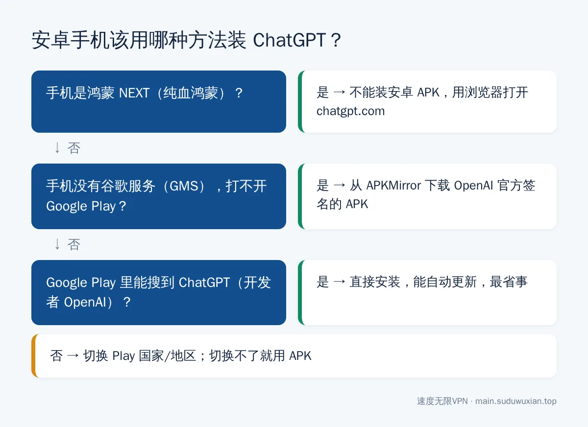
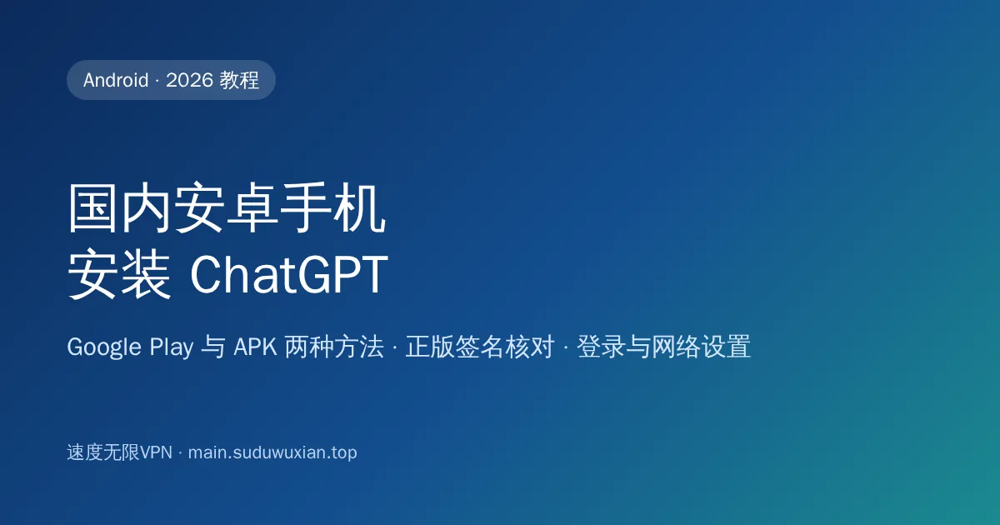

# 国内安卓手机怎么安装 ChatGPT？Google Play 和 APK 两种方法（2026）
<!-- description: 国内安卓手机安装 ChatGPT：有谷歌服务用 Google Play，没有就从 APKMirror 装 OpenAI 官方签名 APK，附 Play 切换国家限制、分应用代理和登录问题排查。 -->

作者：速度无限技术团队 ｜ 最后更新：2026-10-24

**简短回答**：国内安卓手机的自带应用商店里没有 ChatGPT。有谷歌服务的手机，开代理后在 Google Play 搜索安装（开发者认准 OpenAI）；没有谷歌服务、或 Play 提示地区不可用的，从 APKMirror 下载 OpenAI 官方签名的 APK 安装。节点用美国、日本、新加坡等，不要用香港；鸿蒙 NEXT 不能装 APK，只能用网页版。

## 本文要点

- **先看有没有谷歌服务（GMS）**：小米、OPPO、vivo、荣耀等大多能开启；华为 2019 年以后的机型基本没有；鸿蒙 NEXT（纯血鸿蒙）不能安装安卓 APK。
- **方法一 · Google Play**：最正规，能自动更新；Play 的国家/地区是中国时搜不到，切换国家有"每年一次"等限制。
- **方法二 · APK**：不需要谷歌服务，只从可信渠道下载，核对开发者和签名。
- **登录**：没有谷歌服务时"用 Google 登录"可能用不了，改用邮箱。
- **网络**：注意代理软件的"分应用代理"别把 ChatGPT 排除在外。

*图：三个问题判断你该走哪条路。*

## 常见问题速查表

| 现象 | 最可能的原因 | 怎么解决 |
|---|---|---|
| Play 商店打不开 / 一直转圈 | 代理没开，或 Play 被分应用代理排除 | 开启代理，检查分应用代理 |
| Play 提示国家/地区无法使用 | Play 国家是中国 | 按方法一切换；切不了用 APK |
| 安装 APK 被系统拦截 | 未知来源或纯净模式 | 允许未知来源；临时关闭纯净模式 |
| 打开 App 提示 Unsupported country | 节点在香港或不支持的地区 | 换美国 / 日本 / 新加坡节点，彻底关掉 App 重开 |
| 打开 App 一直加载 | ChatGPT 被分应用代理绕过 | 把 `com.openai.chatgpt` 加入代理列表 |
| 点"用 Google 登录"没反应 | 没有谷歌服务 | 改用邮箱登录 |
| 覆盖安装提示签名不一致 | 其中一个安装包不是正版 | 卸载后只从可信渠道重新下载 |

> 📖 **完整内容请阅读原文**：[国内安卓手机怎么安装 ChatGPT？Google Play 和 APK 两种方法（2026）](https://main.suduwuxian.top/android-chatgpt-install-china/)

原文包含分步骤操作说明、示意图、常见问题解答和官方参考资料。

---

> 速度无限：Hysteria2 / VLESS+Reality / AnyTLS 多协议节点，基础套餐 19 元/月起，[qaz.suduwuxian.top](https://qaz.suduwuxian.top)。节点公告和更新请关注 Telegram 频道：[t.me/suduwuxiantop](https://t.me/suduwuxiantop)
