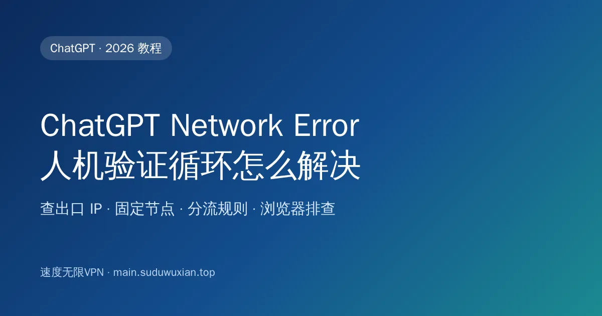
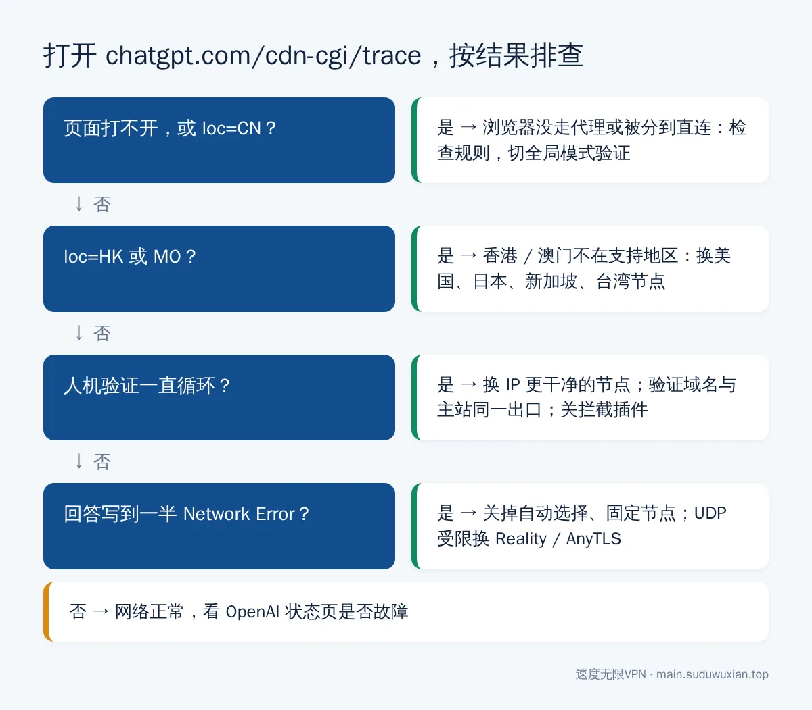
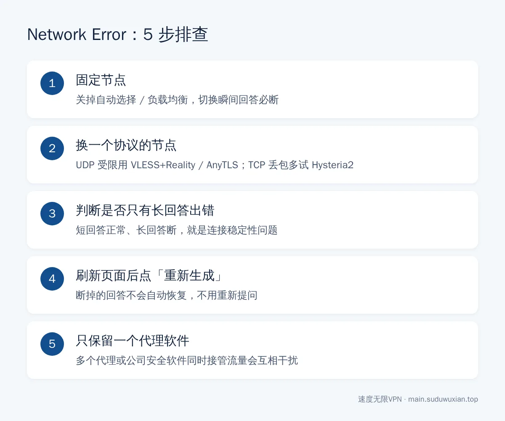

# ChatGPT Network Error、人机验证循环怎么解决？国内使用指南（2026）
<!-- description: ChatGPT 总是 Network Error、Cloudflare 人机验证一直循环、提示地区不支持？先用 cdn-cgi/trace 查出口 IP，再按节点、分流、浏览器三步排查，附速查表。 -->

作者：速度无限技术团队 ｜ 最后更新：2026-10-24

**简短回答**：ChatGPT 的常见报错大多和出口 IP 有关。先打开 `chatgpt.com/cdn-cgi/trace` 看 `loc=`：是 `CN`、`HK`、`MO` 就换美国、日本、新加坡等节点；回答写到一半弹 **Network Error**，多半是节点自动切换或连接不稳，固定节点、换协议即可；**人机验证无限循环**通常是 IP 信誉差，或者 `challenges.cloudflare.com` 和 `chatgpt.com` 走了不同出口，把它们放进同一个策略组，再关掉拦截类浏览器插件。



## 本文要点

- **先查出口 IP**：`chatgpt.com/cdn-cgi/trace` 里的 `loc=` 就是 ChatGPT 看到的你的国家/地区代码；中国大陆、香港、澳门不在 OpenAI 的[支持地区列表](https://help.openai.com/en/articles/7947663)里。
- **Network Error**：提问已发出、回答传回途中连接断了；常见原因是节点自动切换、UDP 被限速、多个代理软件冲突。
- **人机验证循环**：IP 被 Cloudflare 判定为高风险，或验证域名和主站走了不同出口，或浏览器插件拦截了验证脚本。
- **节点选择**：美国、日本、新加坡、台湾都可以，**不要用香港**；固定一个节点比追求最低延迟更重要。
- **账号只自己用**：OpenAI 明确提示在支持地区之外访问可能导致账号被限制，共享账号、来路不明的代充风险更高。

## 开始之前：两分钟判断是哪一类问题

浏览器打开下面这个地址，它是 Cloudflare 提供的[诊断端点](https://developers.cloudflare.com/fundamentals/reference/cdn-cgi-endpoint/)，会显示 ChatGPT 看到的连接信息：

```
https://chatgpt.com/cdn-cgi/trace
```

重点看两行：`ip=` 是你的出口 IP，`loc=` 是这个 IP 所在的国家/地区代码，比如 `US`、`JP`、`SG`、`TW`。



*图：先看 trace 结果，再决定往哪个方向排查。*

| 你看到的 | 说明 | 去看哪一节 |
|---|---|---|
| 页面打不开 | 浏览器根本没走代理 | 第一步 |
| `loc=CN` | 代理开了，但这个网址被分到了直连 | 第一步 |
| `loc=HK` 或 `loc=MO` | 用的是香港 / 澳门节点 | 第一步 |
| `loc` 正常，人机验证一直转圈 | IP 信誉或浏览器问题 | 第三步 |
| `loc` 正常，偶尔弹 Network Error | 连接不稳定 | 第二步 |

---

## 第一步：让 ChatGPT 走对的节点

### 1.1 节点选美国、日本、新加坡或台湾

用香港节点打开 ChatGPT，常见结果是登录后提示 "unsupported_country_region_territory" 或"不支持你所在的国家/地区"。推荐顺序：**美国 > 日本 / 新加坡 / 台湾**。

选好后，**关掉"自动选择""负载均衡"这类策略组**，手动固定一个节点。自动选择会根据测速结果在后台换节点，对 ChatGPT 来说就是"你的 IP 一会儿在东京、一会儿在洛杉矶"，这是 Network Error 和验证循环的常见来源。为什么测速最快的节点不一定最好用，可以看[测速延迟和实际体验为什么不一样](latency-test-vs-real-experience.md)。

### 1.2 规则模式下，相关域名要走同一个出口

ChatGPT 网页会访问好几个域名，它们必须走**同一个策略组**：

| 域名 | 用途 |
|---|---|
| `chatgpt.com`、`openai.com` | 主站和登录 |
| `oaistatic.com`、`oaiusercontent.com` | 静态资源、上传的文件和图片 |
| `challenges.cloudflare.com` | Cloudflare 人机验证 |

打开客户端的"连接"页面，访问一次 ChatGPT，看这几个域名分别走了哪个节点。有的走直连、有的走代理，就在客户端的"覆写 / 扩展配置"里补几条规则（把策略组名换成你订阅里的实际名称）：

```yaml
rules:
  - DOMAIN-SUFFIX,chatgpt.com,你的 AI 策略组名
  - DOMAIN-SUFFIX,openai.com,你的 AI 策略组名
  - DOMAIN-SUFFIX,oaistatic.com,你的 AI 策略组名
  - DOMAIN-SUFFIX,oaiusercontent.com,你的 AI 策略组名
  - DOMAIN,challenges.cloudflare.com,你的 AI 策略组名
```

不确定怎么改，先临时切到"全局模式"验证：全局模式下一切正常，问题就出在分流规则上。策略组的用法见 [Clash Verge 订阅导入与 TUN 模式教程](clash-verge-subscription-tutorial.md)。

### 1.3 电脑上建议开 TUN 模式

ChatGPT 的桌面版、命令行工具不一定读取系统代理。在 Clash Verge 里打开"虚拟网卡模式"（TUN 模式），所有程序的流量都会经过代理。桌面版的安装可以看 [Windows 微软商店安装 ChatGPT](chatgpt-windows-microsoft-store-install-china.md)。

**你应该看到什么**：`chatgpt.com/cdn-cgi/trace` 显示的 `loc=` 是你选的地区，刷新几次都不变。

---

## 第二步：解决 Network Error 和回答中途断掉

"Network Error""Something went wrong""Error in message stream" 的共同点是：**提问已经发出去，回答传回来的过程中连接断了**。ChatGPT 的回答是边生成边传输的，长回答可能持续一两分钟，中间断一下就会报错。



*图：Network Error 按这 5 步依次排查。*

1. **固定节点**：确认已经关掉自动选择，自动切换节点的瞬间，正在传输的回答一定会断。
2. **换一个协议的节点**：公司网络、校园网或部分宽带对 UDP 限速时，Hysteria2 节点的长连接会时断时续，换 VLESS+Reality 或 AnyTLS；反过来，晚高峰 TCP 丢包严重时 Hysteria2 往往更稳。详见[节点和协议怎么选](protocol-choice-guide.md)。
3. **看是不是只有长回答出错**：短问题正常、长回答经常断，基本就是连接稳定性问题。
4. **刷新页面后点"重新生成"**：断掉的回答不会自动恢复，不用重新输入问题。
5. **只保留一个代理软件**：两个代理软件同时运行，或公司安全软件也在接管流量，都会导致连接莫名中断。

**卡住了怎么办**：所有节点都出错、其他网站也慢，先按[节点全部超时怎么办](node-timeout-troubleshooting.md)把基础网络查一遍；再打开 [OpenAI 状态页](https://status.openai.com/)确认是不是 OpenAI 自己出了故障。

---

## 第三步：解决 Cloudflare 人机验证无限循环

现象：页面显示"确认您是真人"或 "Verify you are human"，勾选后转一圈又回到原页面；或提示 "Please unblock challenges.cloudflare.com to proceed"。ChatGPT 由 Cloudflare 防护，它会根据 IP 信誉、浏览器环境等判断访问者是不是机器人（原理见 [Cloudflare Challenges 文档](https://developers.cloudflare.com/cloudflare-challenges/)）。按顺序排查：

### 3.1 换一个 IP 更干净的节点

同一个 IP 被很多人同时使用，或曾被用来大量自动访问，风险分就高，验证更难通过。换同地区的另一个节点试试；如果只在某一个节点上循环、换节点马上正常，就是那个 IP 的信誉问题，可以反馈给服务商。

### 3.2 确认验证域名和主站走同一个出口

就是第一步 1.2 讲的内容。`challenges.cloudflare.com` 走了直连或另一个节点，Cloudflare 看到的"验证人"和"访问人"不是同一个 IP，验证永远通不过。

### 3.3 排除浏览器插件和缓存的干扰

1. 开一个**无痕窗口**访问 `chatgpt.com`，无痕窗口一次通过，问题就在插件或缓存上。
2. 逐个关闭广告拦截、隐私保护、脚本拦截、修改 User-Agent / Referer 的插件，以及浏览器里的其他代理插件。
3. 清除 `chatgpt.com` 和 `openai.com` 的 Cookie 和缓存，重启浏览器。
4. 把浏览器更新到最新版本。

**你应该看到什么**：勾选验证后几秒内进入对话页面，或根本不出现验证。

---

## 第四步：长期稳定使用的习惯

- **固定一个地区、一个节点**，日常就用它。
- **电脑常开 TUN 模式**，网页、桌面版、命令行工具一次覆盖；手机版安装见[安卓手机安装 ChatGPT](android-chatgpt-install-china.md)。
- **少装"隐私增强"类插件**，或把 `chatgpt.com` 加入白名单。
- **账号只自己用**：不要买共享账号、代充，多人在不同地方登录同一个账号，既容易被风控，也有聊天记录泄露的风险。
- **了解官方规则**：OpenAI 在支持地区页面里说明，在列表以外的地区访问服务可能导致账号被限制或停用。

## 常见问题速查表

| 现象 | 最可能的原因 | 怎么解决 |
|---|---|---|
| `chatgpt.com` 打不开 | 浏览器没走代理，或规则把它分到了直连 | 访问 `/cdn-cgi/trace` 查出口；切全局模式验证 |
| 提示地区不支持 / unsupported_country | 出口 IP 在中国大陆、香港或澳门 | 换美国、日本、新加坡、台湾节点 |
| 回答写到一半 Network Error | 节点自动切换或连接不稳定 | 关掉自动选择，固定节点；换协议试试 |
| 只有长回答出错，短回答正常 | 长连接被中断 | 换更稳定的节点；UDP 受限的网络别用 Hysteria2 |
| 人机验证无限循环 | IP 信誉差，或验证域名走了另一个出口 | 换节点；把 `challenges.cloudflare.com` 和主站放进同一策略组 |
| 无痕窗口能用，正常窗口不行 | 插件或缓存干扰 | 关掉拦截类插件，清 Cookie 和缓存 |
| 网页能用，桌面版一直转圈 | 桌面版没走系统代理 | 开 TUN 模式，完全退出后重开 |
| 所有节点都报错 | OpenAI 故障或本地网络问题 | 看 OpenAI 状态页；按节点超时排查法检查 |

## 常见问题

**ChatGPT 为什么不能用香港节点？**
香港、澳门和中国大陆都不在 OpenAI 的支持地区列表里，用这些地区的 IP 访问会提示地区不支持。请换美国、日本、新加坡、台湾等节点。

**ChatGPT 一直 Network Error 怎么办？**
先关掉自动选择、固定一个节点；只有长回答出错时换一个协议的节点（UDP 受限的网络别用 Hysteria2），刷新页面后点"重新生成"即可。

**ChatGPT 人机验证一直循环怎么办？**
换一个 IP 更干净的节点，确认 `challenges.cloudflare.com` 和 `chatgpt.com` 走同一个出口，再用无痕窗口测试并关掉广告拦截、隐私类插件。

**怎么知道 ChatGPT 看到的是哪个国家的 IP？**
打开 `https://chatgpt.com/cdn-cgi/trace`，`loc=` 后面的两位字母就是国家/地区代码，`US` 是美国、`JP` 是日本、`HK` 是香港。

**规则模式和全局模式用哪个？**
日常用规则模式，并让 ChatGPT 相关域名走同一个固定节点；遇到问题时临时切全局模式，能用就说明是分流规则的问题。

---

## 参考资料

- OpenAI 帮助中心：[ChatGPT Supported countries and territories](https://help.openai.com/en/articles/7947663)
- OpenAI：[服务状态页](https://status.openai.com/)
- Cloudflare 文档：[/cdn-cgi/ endpoint](https://developers.cloudflare.com/fundamentals/reference/cdn-cgi-endpoint/)
- Cloudflare 文档：[Cloudflare Challenges](https://developers.cloudflare.com/cloudflare-challenges/)

## 相关阅读

- [国内打不开 ChatGPT、Claude、Gemini？2026 年 AI 工具访问指南](chatgpt-claude-gemini-access-china.md)
- [Claude 稳定访问指南](claude-access-guide.md)
- [Cursor 开发者网络优化手册](cursor-access-guide.md)
- [Gemini 提示国家/地区不可用怎么办](gemini-region-unavailable-fix.md)
- [节点全部超时怎么办？8 步排查法](node-timeout-troubleshooting.md)

---

> 速度无限：Hysteria2 / VLESS+Reality / AnyTLS 多协议节点，基础套餐 19 元/月起，[qaz.suduwuxian.top](https://qaz.suduwuxian.top)。节点公告和更新请关注 Telegram 频道：[t.me/suduwuxiantop](https://t.me/suduwuxiantop)
