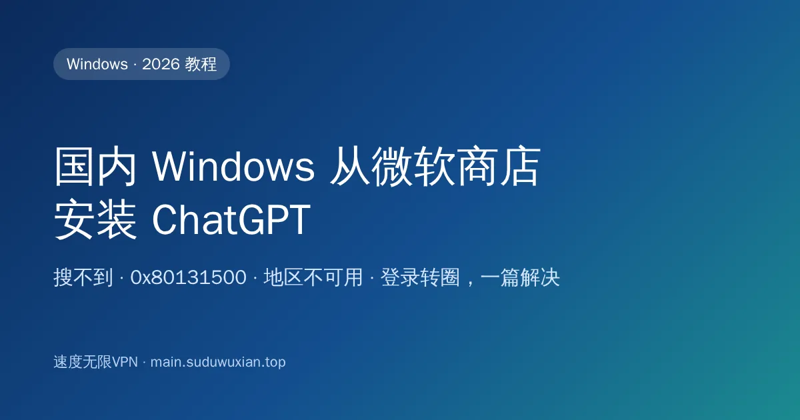
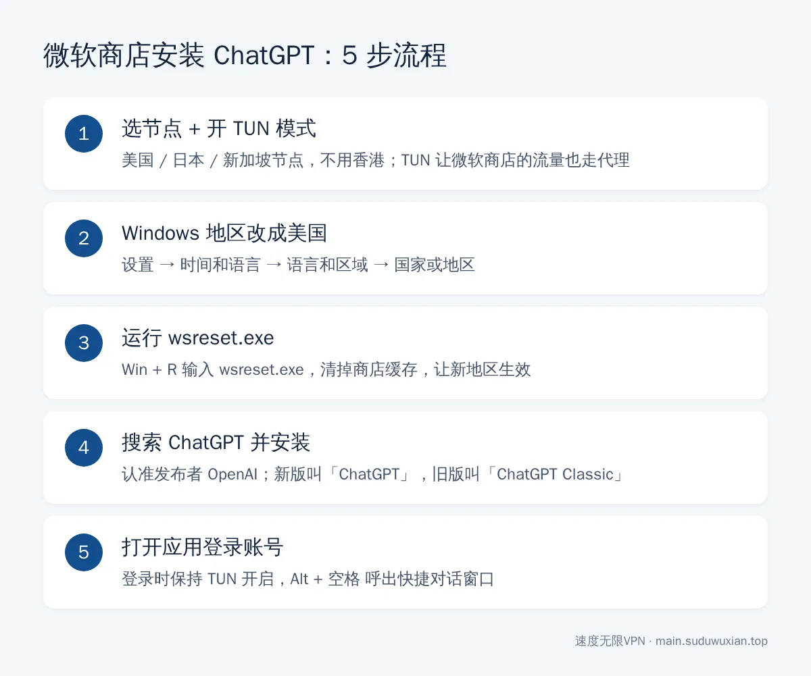
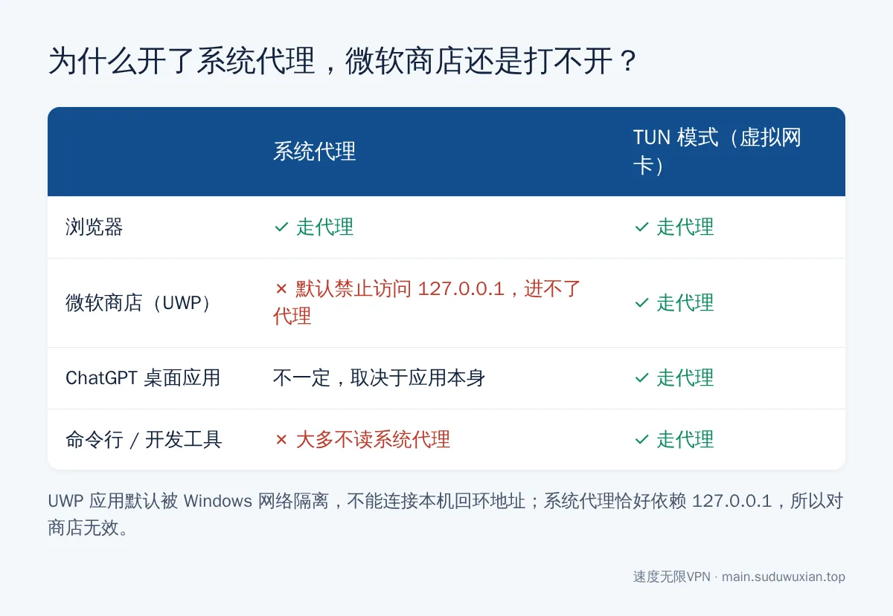

# 国内 Windows 微软商店安装 ChatGPT：搜不到、0x80131500 怎么办（2026）
<!-- description: 国内 Windows 微软商店搜不到 ChatGPT、报错 0x80131500 或提示地区不可用？开 TUN、改系统地区、运行 wsreset 后安装，附新版与 ChatGPT Classic 区别和排错表。 -->

作者：速度无限技术团队 ｜ 最后更新：2026-10-24

**简短回答**：国内 Windows 电脑在微软商店搜不到 ChatGPT，是因为 ChatGPT 没有在中国区商店上架；开了代理商店还是打不开，是因为微软商店属于 UWP 应用，默认不走系统代理。解决办法是：选美国等支持地区的节点并开启 **TUN 模式** → 把 Windows 的"国家或地区"改成美国 → 运行 `wsreset.exe` 重置商店 → 搜索并安装发布者为 OpenAI 的 ChatGPT。整个过程 10 分钟左右。



## 本文要点

- **为什么搜不到**：ChatGPT 没有在中国大陆区的微软商店上架，商店按"Windows 设置里的国家或地区"决定显示哪些应用，跟 IP 无关。
- **为什么开了代理商店还打不开**：UWP 应用默认不能访问本机 `127.0.0.1`，系统代理对它无效，要用 TUN 模式。
- **新版和旧版**：2026 年 7 月起，OpenAI 推出整合了 Chat、Work 和 Codex 的新版 ChatGPT 桌面应用，旧版改名为 **ChatGPT Classic**，两个都在商店里，都能用。
- **节点**：美国、日本、新加坡、台湾都可以，**不要用香港**，香港不在 OpenAI 支持的地区里。
- **装完之后**：地区可以改回中国，但 ChatGPT 联网仍然需要代理，建议一直开着 TUN。

## 开始之前，准备好这几样东西

1. **Windows 10（版本 17763 或更高）或 Windows 11**，x64 和 ARM64 都支持。系统太旧的话先去"设置 → Windows 更新"更新一下。
2. **一个能用的代理客户端和节点**。本文以 Clash Verge 为例，v2rayN 思路一样，可以参考 [v2rayN 新手订阅教程](v2rayn-subscription-beginner-tutorial.md)。
3. **一个 OpenAI 账号**。没有也可以装好后在应用里注册。
4. **微软账号不是必须的**，商店下载免费应用一般不需要登录。



*图：完整流程一图看懂，下面逐步展开。*

---

## 第一步：选对节点，打开 TUN 模式

### 1.1 节点选美国、日本、新加坡或台湾

OpenAI 官方公布的[支持国家和地区列表](https://help.openai.com/en/articles/7947663-chatgpt-supported-countries-and-territories)里**没有中国大陆，也没有香港**。用香港节点打开 ChatGPT，常见结果是提示 `Unsupported country, region, or territory`，或者登录页一直转圈。

推荐顺序：**美国 > 日本 / 新加坡 > 台湾**。如果机场有"原生 IP""AI 专用"节点，优先用。不清楚节点和协议怎么挑，可以看[节点和协议怎么选](protocol-choice-guide.md)。

### 1.2 为什么一定要开 TUN 模式

很多人开着 Clash 的"系统代理"，浏览器能上 Google，微软商店却显示"出了点问题"或错误代码 `0x80131500`。

原因是：微软商店是 UWP 应用，Windows 默认不允许 UWP 应用连接本机回环地址（微软在 [UWP 应用连接问题排查文档](https://learn.microsoft.com/en-us/windows/security/operating-system-security/network-security/windows-firewall/troubleshooting-uwp-firewall) 里把这一点列为常见原因）。而系统代理的原理恰恰是把流量交给 `127.0.0.1:7897` 这样的本地端口，所以商店的流量进不了代理软件。



*图：系统代理只对会读取它的程序有效，TUN 模式接管所有程序的流量。*

**方法 A：开 TUN 模式（推荐）**

在 Clash Verge 里：

1. 打开"设置"，找到 **TUN 模式**（中文界面里可能叫"虚拟网卡模式"）。
2. 第一次开启会提示安装"服务模式"，点安装，在管理员权限窗口里点"是"。
3. 打开 TUN 开关，"系统代理"可以关掉，避免冲突。

**你应该看到什么**：开关变成开启状态；浏览器不设置任何代理也能打开 google.com。TUN 模式的完整设置见 [Clash Verge 订阅教程](clash-verge-subscription-tutorial.md)。

**方法 B：只给微软商店解除回环限制**

不想开 TUN 的话，用**管理员身份**打开 PowerShell，输入：

```powershell
CheckNetIsolation LoopbackExempt -a -n="Microsoft.WindowsStore_8wekyb3d8bbwe"
```

看到"完成"就成功了。部分代理客户端的设置里也带有图形化的 UWP 回环解除工具。注意方法 B 只解决商店的问题，ChatGPT 应用本身是否走代理还要看应用，实际使用中最稳的仍是方法 A。

---

## 第二步：把 Windows 的"国家或地区"改成美国

微软商店显示哪些应用，看的是 Windows 设置里的"国家或地区"，不是你的 IP。

- **Windows 11**：设置 → 时间和语言 → 语言和区域 → 区域 → **国家或地区**，选"美国"。
- **Windows 10**：设置 → 时间和语言 → 区域 → **国家或地区**，选"美国"。

这个设置只影响商店和部分地区性内容，不改系统语言、输入法和时间。日期格式变成美式的话，在同一页面的"区域格式"里改回"中文（简体，中国）"即可。

---

## 第三步：运行 wsreset.exe 重置商店缓存

改完地区后，商店往往还记着旧地区，需要重置缓存：

1. 完全关闭微软商店。
2. 按 `Win + R`，输入 `wsreset.exe`，回车。
3. 弹出一个空白命令行窗口，大约 10 秒后自动关闭并重新打开商店（[微软官方说明](https://support.microsoft.com/en-au/windows/microsoft-store-doesn-t-launch-reset-the-cache-df2aea11-6338-418a-9515-434c5e910adb)）。

**你应该看到什么**：商店首页的推荐内容变成英文或美区应用，说明地区切换成功。

---

## 第四步：搜索并安装 ChatGPT

在商店搜索 `ChatGPT`，你可能会看到两个结果，**发布者都应该是 OpenAI**：

| 商店里的名字 | 是什么 | 适合谁 |
|---|---|---|
| ChatGPT | 2026 年 7 月推出的新版桌面应用，整合了 Chat、Work 和 Codex | 大多数人，新功能只在新版上线 |
| ChatGPT Classic | 原来的 Windows 桌面应用，仍在维护 | 只想要纯聊天、或公司要求用旧版的人 |

两个版本的区别和迁移说明见 OpenAI 的[《迁移到新版 ChatGPT 桌面应用》](https://help.openai.com/en/articles/20001276-moving-to-the-new-chatgpt-desktop-app)。最省事的入口是 OpenAI 官方下载页 [chatgpt.com/download](https://chatgpt.com/download/)，它会把你带到正确的商店页面。

商店里还有大量名字带 ChatGPT、AI Chat 的第三方套壳应用，有的收费、有的收集数据，**认准发布者 OpenAI 再装**。

**用 winget 命令行安装**

打开 PowerShell，先按名字搜索，确认 ID 和发布者：

```powershell
winget search ChatGPT --source msstore
```

找到发布者为 OpenAI 的那一项后，用它的 ID 安装。比如 ChatGPT Classic 的商店 ID 是 `9NT1R1C2HH7J`：

```powershell
winget install --id 9NT1R1C2HH7J --source msstore
```

第一次使用会让你同意 msstore 源协议，输入 `Y` 回车即可。

**你应该看到什么**：进度条走完，开始菜单出现 ChatGPT 图标。

---

## 第五步：打开 ChatGPT，登录账号

打开应用，点 **Log in** 或 **Sign up**，会跳到浏览器完成登录，然后自动回到应用。

**登录时保持 TUN 开启，并确认当前节点不是香港。** 登录后可以按 `Alt + 空格` 呼出快捷对话窗口；如果这个快捷键被别的软件占用，在应用的 设置 → App 里修改（[OpenAI Windows 应用说明](https://help.openai.com/en/articles/9982051-using-the-chatgpt-windows-app)）。

---

## 第六步（可选）：把地区改回中国

装好之后可以把"国家或地区"改回中国，已安装的应用不会被删除。不过有用户反馈改回后商店不再推送更新；需要更新时，临时切回美国、运行一次 `wsreset.exe`，再去商店"库"里更新即可。

---

## 常见问题速查表

| 现象 | 最可能的原因 | 怎么解决 |
|---|---|---|
| 商店里搜不到 ChatGPT | 地区还是中国，或缓存没刷新 | 地区改美国 → `wsreset.exe` → 或从 chatgpt.com/download 进入 |
| 提示"此应用在你所在的国家或地区不可用" | 商店按系统地区判断 | 同上 |
| 商店打不开，错误 `0x80131500` 或"出了点问题" | UWP 回环限制，商店进不了代理 | 开 TUN，或用 CheckNetIsolation 解除限制 |
| 一直卡在"正在下载" | 下载队列卡住或节点慢 | 暂停后继续；换速度快的节点；重启电脑 |
| 打开 ChatGPT 白屏、转圈 | 应用流量没走代理 | 开 TUN，完全关闭应用后重开 |
| 提示 `Unsupported country, region, or territory` | 节点在香港或不支持的地区 | 换美国 / 日本 / 新加坡节点 |
| 登录时人机验证一直循环 | 节点 IP 被大量共用、被风控 | 换节点，优先"原生 IP"节点 |
| 对话中途断开、Network Error | 节点不稳或自动切换 | 固定一个节点，参考[节点全部超时怎么办](node-timeout-troubleshooting.md) |

---

## 常见问题

**微软商店里的 ChatGPT 和 ChatGPT Classic 装哪个？**
一般装新版"ChatGPT"，新功能只在新版上线；只想要以前的纯聊天界面，或公司要求旧版时，装 ChatGPT Classic。两个都由 OpenAI 发布、都在维护。

**装完 ChatGPT 之后，Windows 地区可以改回中国吗？**
可以，应用不会被删除，正常使用不受影响。只是商店可能不推送更新，需要更新时再临时切回美国区。

**开了系统代理，为什么微软商店还是报 0x80131500？**
微软商店是 UWP 应用，默认不能连接本机的 127.0.0.1，系统代理对它无效。开 TUN 模式，或用 CheckNetIsolation 命令给商店解除回环限制。

**用香港节点可以登录 ChatGPT 吗？**
不可以。香港不在 OpenAI 支持的国家和地区列表里，会提示地区不支持或一直转圈，请换美国、日本、新加坡等节点。

**公司电脑商店被禁用了怎么办？**
可以用 Edge 或 Chrome 打开 chatgpt.com 并登录，在浏览器菜单里选择"将此站点作为应用安装"，开始菜单会出现一个独立的 ChatGPT 窗口。

---

## 实在装不上？用浏览器装成应用

- **Edge**：打开 `chatgpt.com` 并登录 → 右上角"…" → 应用 → 将此站点作为应用安装。
- **Chrome**：打开 `chatgpt.com` 并登录 → 右上角"⋮" → 投放、保存和分享 → 将网页安装为应用（不同版本菜单名称略有差别）。

缺点是没有 `Alt + 空格` 全局快捷键。

---

## 参考资料

- OpenAI 帮助中心：[ChatGPT 支持的国家和地区](https://help.openai.com/en/articles/7947663-chatgpt-supported-countries-and-territories)
- OpenAI 帮助中心：[Using the ChatGPT Windows app](https://help.openai.com/en/articles/9982051-using-the-chatgpt-windows-app)
- OpenAI 帮助中心：[Moving to the new ChatGPT desktop app](https://help.openai.com/en/articles/20001276-moving-to-the-new-chatgpt-desktop-app)
- OpenAI：[ChatGPT 官方下载页](https://chatgpt.com/download/)
- Microsoft Learn：[Troubleshooting UWP App Connectivity Issues](https://learn.microsoft.com/en-us/windows/security/operating-system-security/network-security/windows-firewall/troubleshooting-uwp-firewall)
- Microsoft 支持：[重置 Microsoft Store 缓存（wsreset）](https://support.microsoft.com/en-au/windows/microsoft-store-doesn-t-launch-reset-the-cache-df2aea11-6338-418a-9515-434c5e910adb)

## 相关阅读

- [ChatGPT / Claude / Gemini 国内访问指南](chatgpt-claude-gemini-access-china.md)
- [国内 Windows 电脑怎么安装 Claude 桌面版](claude-windows-desktop-install-china.md)
- [Mac 上怎么安装 ChatGPT 和 Claude 桌面版](mac-chatgpt-claude-install-china.md)
- [国内安卓手机怎么安装 ChatGPT](android-chatgpt-install-china.md)
- [Claude Code / Codex 配合 Clash Meta TUN 模式](claude-code-codex-clash-meta-tun.md)

---

> 速度无限：Hysteria2 / VLESS+Reality / AnyTLS 多协议节点，基础套餐 19 元/月起，[qaz.suduwuxian.top](https://qaz.suduwuxian.top)。节点公告和更新请关注 Telegram 频道：[t.me/suduwuxiantop](https://t.me/suduwuxiantop)
