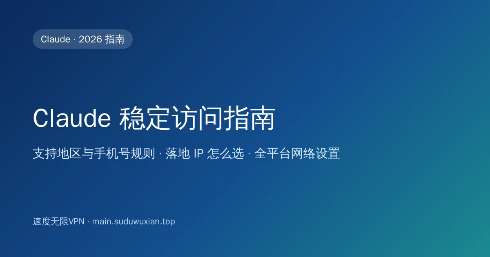
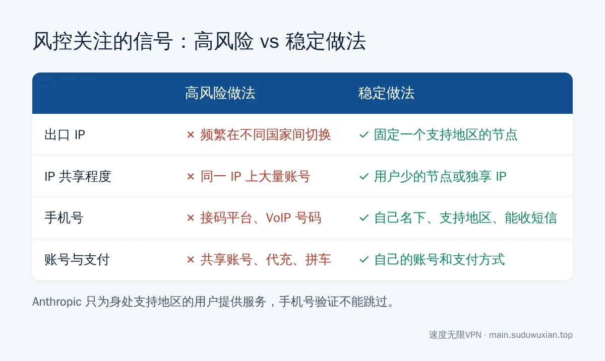
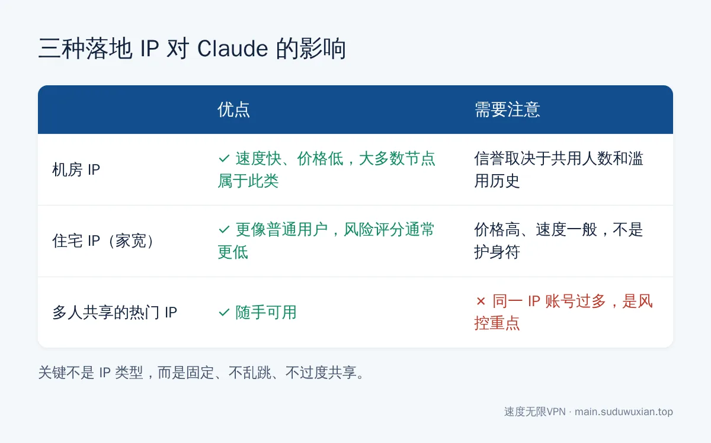

# Claude 稳定访问指南：落地 IP、手机号验证与封号风险（2026）
<!-- description: Claude 打不开、注册要手机号、担心被封号？讲清 Anthropic 支持地区和手机号验证规则，落地 IP 怎么选、为什么要固定节点，以及电脑、手机、Claude Code 的网络设置。 -->

作者：速度无限技术团队 ｜ 最后更新：2026-10-24

**简短回答**：先了解官方规则：Anthropic 只为**身处支持地区**的用户提供 Claude，注册时必须验证**支持地区的手机号**，这一步不能跳过，也不接受虚拟号码。在此前提下，网络上能做的是让环境稳定、可信：用美国、日本、新加坡等支持地区的**固定节点**，不要频繁切换国家，不和大量用户共用同一个出口 IP；电脑开 TUN 模式，让网页、桌面版和 Claude Code 走同一个出口。



## 本文要点

- **官方规则**：Claude 只对身处[支持地区](https://www.anthropic.com/supported-countries)的用户开放，中国大陆和香港不在其中；注册必须用支持地区、能收短信的手机号（[官方说明](https://support.claude.com/en/articles/8287232-verify-your-phone-number)）。
- **落地 IP 是什么**：Claude 看到的是代理的出口 IP；比起"是不是住宅 IP"，**稳定不乱跳、不和太多人共用**更重要。
- **不要用接码平台、虚拟号码、共享账号**：既违反服务条款，也是账号被停用的高发原因。
- **最容易出事的行为**：频繁切换国家、多人共用账号、同一 IP 注册多个账号、使用来路不明的代充。
- **全平台设置**：网页、桌面版、手机 App、Claude Code 用同一个地区的节点；电脑开 TUN，手机注意分应用代理。

## 先说清楚：Claude 的地区和手机号规则

很多"防封秘籍"回避了一个事实：Claude 的服务范围是有明确规定的。根据 Claude 帮助中心的[手机号验证说明](https://support.claude.com/en/articles/8287232-verify-your-phone-number)（截至 2026 年 8 月的版本）：

- 只有**身处支持地区**的用户可以创建和使用 Claude 账号；
- 注册时必须验证一个**支持地区的手机号**，所有新用户都要验证，没有办法跳过；
- **不接受** VoIP 号码、Google Voice、App 生成的号码、座机等不能收短信的号码。

所以本文不会教你"绕过验证"。如果你人在支持地区（比如在海外学习、工作、出差），或者有合法的支持地区手机号，下面的内容能帮你把网络环境配置稳定，减少因为网络异常导致的误判。如果你身处不支持的地区，请先读一读 Anthropic 的[消费者条款](https://www.anthropic.com/legal/consumer-terms)，自行评估风险。

---

## 第一步：选对地区，固定节点

### 1.1 选支持的地区

推荐顺序：**美国 > 日本 / 新加坡 / 台湾**。用香港节点打开 `claude.ai`，一般会直接提示地区不可用。

### 1.2 固定一个节点，关掉自动切换

这是最重要、也最容易被忽视的一步：

- 在客户端里**手动选定一个节点**，日常就用它；
- 关掉"自动选择""负载均衡""故障转移"这类策略组，它们会在后台悄悄换节点；
- 节点暂时坏了，**优先换同一个国家的其他节点**，不要一下子跳到另一个大洲。

### 1.3 查一下你的出口 IP

打开 `https://claude.ai/cdn-cgi/trace`，看 `loc=` 后面的国家代码是不是你选的地区（`US`、`JP`、`SG`、`TW` 等）。

**你应该看到什么**：每次刷新，出口 IP 都在同一个国家，最好是同一个 IP。

**卡住了怎么办**：每次刷新国家都不一样，说明还开着自动选择或负载均衡，回到 1.2 关掉。



*图：风控会把 IP、账号信息和支付信息放在一起看。*

---

## 第二步：落地 IP 要不要"住宅 IP"

网上很多文章把"原生住宅 IP"说成用 Claude 的必需品，实际情况是这样的：



*图：三种落地 IP 的区别。关键在于稳定和不过度共享。*

| 类型 | 是什么 | 对 Claude 的影响 |
|---|---|---|
| 机房 IP | 数据中心的 IP，大多数机场节点属于这一类 | 能正常使用；信誉取决于这个 IP 上的用户多不多、有没有被滥用 |
| 住宅 IP（家宽 IP） | 运营商分配给家庭宽带的 IP | 更像普通用户，风险评分通常更低，但价格高、速度一般 |
| 多人共享的热门 IP | 很多人同时在用的同一个出口 | 同一 IP 上出现大量账号，是风控关注的重点 |

建议：

1. **大多数人用正规机场的固定节点就够了**，关键是固定、不乱跳。
2. 账号对你很重要（比如工作账号），可以考虑独享 IP 或住宅 IP，用链式代理挂在机场节点后面，做法见[链式代理怎么设置](https://main.suduwuxian.top/lianshi-daili-shezhi/)和[独享 SOCKS5 中转设置](dedicated-socks5-relay-setup-guide.md)。
3. **住宅 IP 不是护身符**：账号本身违反条款（共享、转卖、虚假注册信息），换什么 IP 都没用。

---

## 第三步：注册、付费时的注意事项

- **先把节点切好、固定好**，再打开注册页面；不要先直连打开，发现不行再开代理。
- **邮箱**用你自己长期使用的 Gmail、Outlook，或直接用 Google 账号登录；不要用临时邮箱，账号出问题时要靠它和官方沟通。
- **手机号**只用自己名下、能收短信的支持地区号码。**不要用接码平台**：接码号码是多人轮流使用的，同一个号码可能绑过很多被封的账号；号码回收后别人还能用它收你的验证码。
- **付费订阅**用你自己名下的支付方式；不要找代充、拼车、低价共享账号，这类账号来路不明、多人共用，被停用后没有任何申诉渠道。
- 使用前花几分钟看看 Anthropic 的[使用政策](https://www.anthropic.com/legal/aup)，避免因内容违规导致账号受限。

---

## 第四步：全平台的网络设置

同一个账号在多个设备上用，原则是**所有设备都用同一个地区的节点**。

### 4.1 电脑：网页版、桌面版、Claude Code

- 网页版：浏览器走代理即可。
- 桌面版：建议在 Clash Verge 里开"虚拟网卡模式"（TUN 模式），桌面版的 MCP 工具会启动其他程序联网，它们不一定读取系统代理。安装步骤见 [Windows 安装 Claude 桌面版](claude-windows-desktop-install-china.md) 和 [Mac 安装 ChatGPT 和 Claude](mac-chatgpt-claude-install-china.md)。
- Claude Code：命令行工具不会自动读取系统代理，开 TUN 最省事，详见 [Claude Code、Codex 配合 Clash Meta TUN 模式](claude-code-codex-clash-meta-tun.md)。

### 4.2 手机：Claude App

- 安卓：Clash Meta for Android 等客户端默认接管所有应用；开了"分应用代理"的话，要确认 Claude 在代理列表里。
- iPhone：用小火箭、Clash Mi 等客户端，选好节点后保持连接；Claude App 需要从支持地区的 App Store 下载，**用自己注册的 Apple ID，不要用别人共享的**。

### 4.3 规则模式下的分流

Claude 相关的域名主要是 `claude.ai`、`claude.com`、`anthropic.com`。订阅规则里没有的话，可以在覆写配置里补上：

```yaml
rules:
  - DOMAIN-SUFFIX,claude.ai,你的 AI 策略组名
  - DOMAIN-SUFFIX,claude.com,你的 AI 策略组名
  - DOMAIN-SUFFIX,anthropic.com,你的 AI 策略组名
```

**你应该看到什么**：在客户端的"连接"页面里，Claude 相关的请求都走同一个固定节点。

---

## 第五步：日常使用的好习惯

- **不要频繁切换国家**：今天美国、明天日本，是最典型的高风险行为。
- **一个人一个账号**，不借给别人，也不多人共用。
- **同一个 IP 上不要注册一堆账号**。
- **不要在第三方"镜像站""中转站"登录你的账号**，那等于把账号交给别人。
- **账号被停用**：通过官方渠道申诉，如实说明情况；不要马上换 IP 注册新号，这往往会让新号也受影响。

更多关于封号原因的分析，见[用了 VPN 还是被 Claude 封号？真正的雷区在这里](claude-account-ban-vpn-myth.md)。

## 常见问题速查表

| 现象 | 最可能的原因 | 怎么解决 |
|---|---|---|
| 打开提示 App unavailable / 地区不可用 | 节点在香港或其他不支持的地区 | 换美国、日本、新加坡、台湾节点 |
| 每次查 IP 国家都不一样 | 开着自动选择或负载均衡 | 改成手动固定节点 |
| 注册时要求手机号 | 所有新用户都必须验证 | 用自己名下、支持地区、能收短信的号码；不能跳过 |
| 收不到验证码 / Error sending code | 号码类型不支持或输错 | 等 5 分钟后重试；VoIP、Google Voice 号码不能用 |
| 刚注册就被停用 | 同 IP 账号过多、注册信息异常 | 用固定的干净节点和自己的长期邮箱；按官方渠道申诉 |
| 网页能用，桌面版或 Claude Code 连不上 | 程序没走系统代理 | 开 TUN 模式 |
| 手机 App 连不上，电脑正常 | 分应用代理把 Claude 排除了 | 把 Claude 加入代理列表 |

## 常见问题

**Claude 注册必须要手机号吗？**
必须。Claude 帮助中心说明所有新用户都要验证支持地区、能收短信的手机号，这一步不能跳过，VoIP 和 Google Voice 号码也不行。

**用接码平台注册 Claude 可以吗？**
不建议。接码号码是多人轮流使用的，常常已经关联过被封账号，号码回收后别人还能收到你的验证码，而且这样做违反服务条款。

**Claude 一定要用住宅 IP 吗？**
不一定。大多数情况下，正规机场的固定节点就够用；重要的是出口 IP 稳定、不频繁跨国切换、不和大量用户共用。

**用香港节点能用 Claude 吗？**
不能。中国大陆和香港都不在 Anthropic 的支持地区里，请用美国、日本、新加坡、台湾等节点。

**Claude 账号被停用了怎么办？**
通过官方渠道申诉并如实说明使用情况；不要立刻换 IP 注册新账号，也不要购买别人的账号。

---

## 参考资料

- Anthropic：[Supported countries & regions](https://www.anthropic.com/supported-countries)
- Claude 帮助中心：[Verify your phone number](https://support.claude.com/en/articles/8287232-verify-your-phone-number)
- Anthropic：[Consumer Terms of Service](https://www.anthropic.com/legal/consumer-terms)
- Anthropic：[Usage Policy](https://www.anthropic.com/legal/aup)

## 相关阅读

- [用了 VPN 还是被 Claude 封号？真正的雷区在这里](claude-account-ban-vpn-myth.md)
- [国内 Windows 安装 Claude 桌面版](claude-windows-desktop-install-china.md)
- [Claude Code、Codex 配合 Clash Meta TUN 模式](claude-code-codex-clash-meta-tun.md)
- [ChatGPT 国内使用指南](chatgpt-access-guide.md)
- [Cursor 开发者网络优化手册](cursor-access-guide.md)

---

> 速度无限：Hysteria2 / VLESS+Reality / AnyTLS 多协议节点，基础套餐 19 元/月起，[qaz.suduwuxian.top](https://qaz.suduwuxian.top)。节点公告和更新请关注 Telegram 频道：[t.me/suduwuxiantop](https://t.me/suduwuxiantop)
