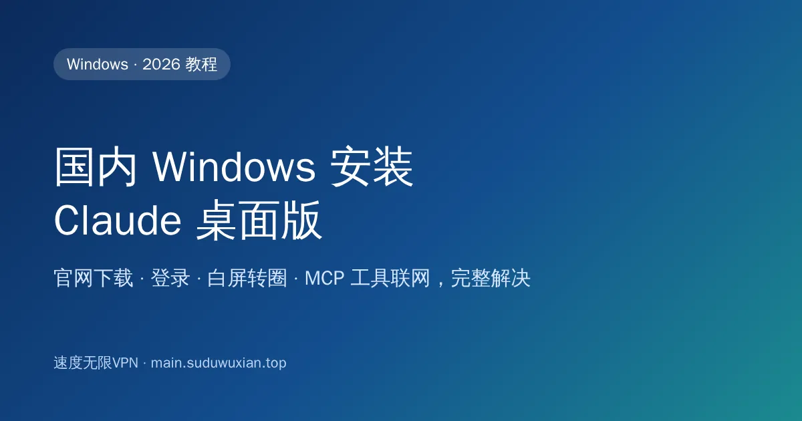
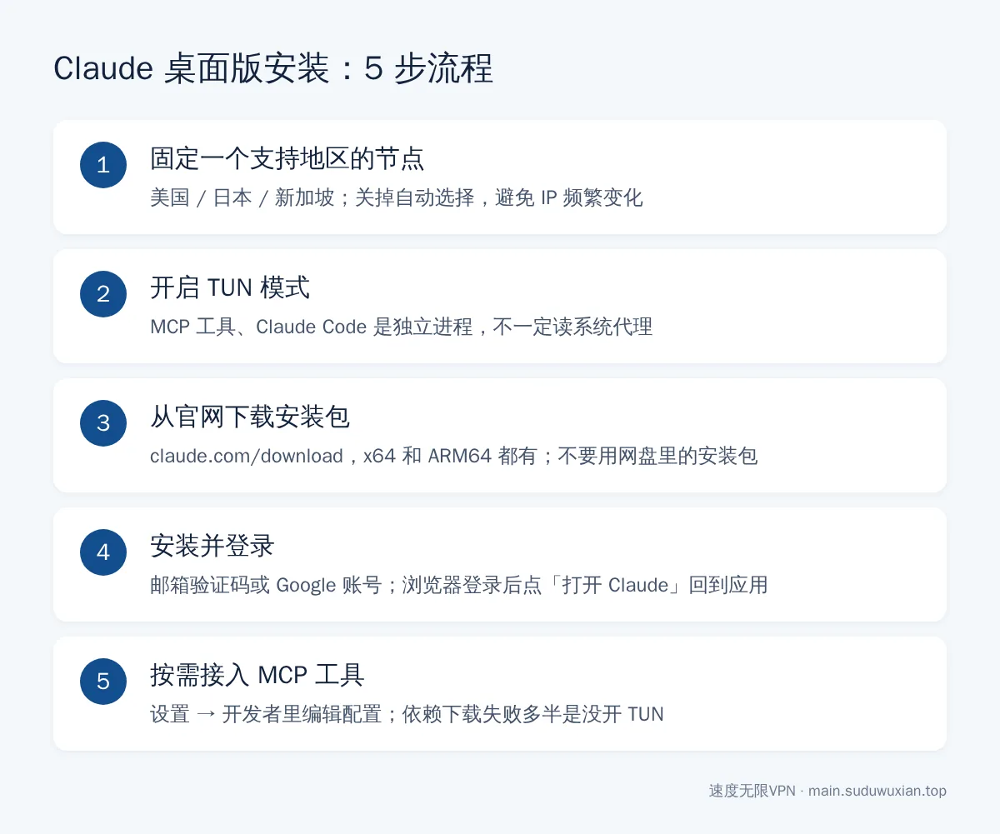
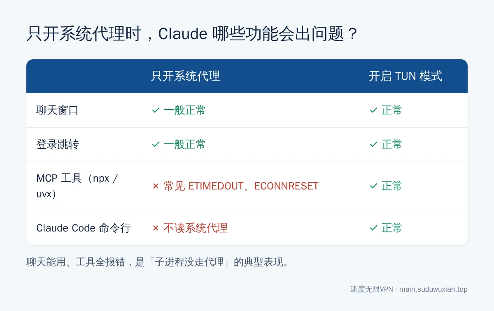

# 国内 Windows 安装 Claude 桌面版：下载、登录、白屏转圈解决（2026）
<!-- description: Claude 桌面版 Windows 安装教程：官网或 winget 下载，固定支持地区节点并开 TUN，解决白屏转圈、地区不可用、收不到验证码和 MCP 工具报错。 -->

作者：速度无限技术团队 ｜ 最后更新：2026-10-24

**简短回答**：Claude 桌面版不需要微软商店，直接从官网 [claude.com/download](https://claude.com/download) 下载安装包即可，系统要求 Windows 10 及以上。国内装好后打不开、白屏或提示地区不可用，几乎都是网络问题：用美国、日本、新加坡等**支持地区的固定节点**，并开启 **TUN 模式**，让 Claude 和它启动的 MCP 工具都走代理。



## 本文要点

- **安装包从哪下**：只从官网下载页下载，x64 和 ARM64 都有；网盘、群文件里的"中文版""免登录版"一律不要。
- **节点怎么选**：Anthropic 的[支持地区列表](https://www.anthropic.com/supported-countries)里没有中国大陆和香港；用美国、日本、新加坡等节点，并**固定一个，不要频繁切换**。
- **为什么要开 TUN**：MCP 工具、Claude Code 是独立进程，不一定读取系统代理，只开系统代理会出现"聊天能用、工具全报错"。
- **登录**：邮箱验证码或 Google 账号都可以，登录前就把节点切好。
- **账号安全**：频繁换 IP、共享节点、使用不支持地区的支付方式，是被风控的常见诱因。

## 开始之前，准备好这几样东西

1. **Windows 10 或 Windows 11**（[官方安装说明](https://support.claude.com/en/articles/10065433-installing-claude-desktop)写的最低要求是 Windows 10）。
2. **一个能用的代理客户端和节点**，本文以 Clash Verge 为例，导入订阅见 [Clash Verge 订阅教程](clash-verge-subscription-tutorial.md)。
3. **一个 Claude 账号**，没有的话可以在桌面版里注册，建议用 Gmail、Outlook 等海外邮箱。



*图：完整流程一图看懂，下面逐步展开。*

---

## 第一步：选好节点，打开 TUN 模式

### 1.1 节点选择

用香港节点打开 Claude，通常会看到地区不可用的提示。推荐顺序：**美国 > 日本 / 新加坡 / 台湾**。另外两条建议：

- **固定一个节点长期使用**。同一个账号今天美国、明天日本、后天新加坡，是最容易触发风控的行为之一。为什么会被封、和 VPN 到底有没有关系，详见[用了 VPN 还是被 Claude 封号？](claude-account-ban-vpn-myth.md)
- **关掉"自动选择""负载均衡"策略组**，它们会在后台自动换节点。

### 1.2 打开 TUN 模式

在 Clash Verge 的"设置"里找到 **TUN 模式**（中文界面可能叫"虚拟网卡模式"），第一次开启按提示安装服务模式，然后打开开关，"系统代理"可以关掉。



*图：聊天能用、工具全报错，是"子进程没走代理"的典型表现。*

Claude 桌面版本身基于 Chromium 内核，一般会读取系统代理，所以只开系统代理时聊天通常没问题。但桌面版接入的 MCP 服务器、Claude Code 是单独的程序，很多不读系统代理。命令行工具的网络问题可以参考 [Claude Code、Codex 装完打不开？](claude-code-codex-clash-meta-tun.md)

---

## 第二步：从官网下载安装包

浏览器打开 Claude 官网下载页：

```
https://claude.com/download
```

选择 **Windows**。骁龙处理器的 ARM 笔记本选 **ARM64** 版本，性能和续航更好。

**用 winget 安装**

```powershell
winget search Claude
winget install --id Anthropic.Claude
```

先用第一条确认发布者是 Anthropic，再安装。注意 `Anthropic.ClaudeCode` 是命令行工具 Claude Code，不是桌面版。

> ⚠️ 网上流传的"Claude 中文版""破解版""免登录版"安装包一律不要装。官方桌面版本身支持中文界面。

---

## 第三步：安装并打开

双击安装包，安装过程没有需要选择的选项，装完自动打开。

**你应该看到什么**：Claude 的登录界面，有"Continue with Google"和"Continue with email"两个选项。

**如果一直白屏或转圈**：确认 TUN 已开启 → 任务栏右下角右键 Claude 图标退出 → 重新打开。

---

## 第四步：登录账号

- **邮箱登录**：输入邮箱，去邮箱找 Anthropic 发来的验证码或登录链接。点链接跳到浏览器后，浏览器会提示"打开 Claude"，点允许即可回到桌面版。
- **Google 登录**：跳浏览器完成授权后同样自动跳回。

登录后可以在设置里打开开机自启、设置快捷键，或把界面语言切换成中文。

---

## 第五步（可选）：接入 MCP 工具

[MCP（Model Context Protocol）](https://modelcontextprotocol.io/)是让 Claude 调用外部工具的开放协议，比如读写本地文件夹、操作浏览器、查数据库。在桌面版的 设置 → 开发者（Developer）里可以编辑配置文件添加 MCP 服务器。

最常见的坑是网络：很多 MCP 服务器通过 `npx`、`uvx` 启动，需要从 npm、PyPI 下载依赖，**没开 TUN 时经常超时**，日志里出现 `ETIMEDOUT`、`ECONNRESET`。开 TUN 后重启 Claude 一般就好了。

---

## 常见问题速查表

| 现象 | 最可能的原因 | 怎么解决 |
|---|---|---|
| 官网下载页打不开 | 浏览器没走代理 | 确认代理已开启，换个节点 |
| 打开后白屏或转圈 | 程序没连上网络 | 开 TUN，完全退出 Claude 后重开 |
| 提示 App unavailable / 地区不可用 | 节点在香港或不支持的地区 | 换美国、日本、新加坡节点 |
| 邮箱收不到验证码 | 进了垃圾箱，或国内邮箱拦截 | 查垃圾邮件；改用 Gmail、Outlook |
| 点了登录链接没跳回 Claude | 浏览器拦截了打开应用的请求 | 在弹窗中点"打开 Claude"，或手动输入验证码 |
| 聊天正常，MCP 工具全部报错 | MCP 子进程没走代理 | 开 TUN；检查 Node.js / Python 是否安装 |
| 节点测速全红、什么都连不上 | 订阅、时间、内核等本地问题 | 按[节点全部超时 8 步排查法](node-timeout-troubleshooting.md)逐项检查 |

---

## 常见问题

**Claude 桌面版可以在微软商店下载吗？**
不需要。Claude 桌面版直接从官网 claude.com/download 下载安装包，也可以用 `winget install --id Anthropic.Claude` 安装，不用改 Windows 地区。

**Claude 桌面版支持哪些系统？**
官方要求 Windows 10 及以上（提供 x64 和 ARM64 版本），以及 macOS 11 及以上，不支持 Linux。

**用香港节点能登录 Claude 吗？**
不能。中国大陆和香港都不在 Anthropic 支持的地区里，请用美国、日本、新加坡等节点，并尽量固定使用同一个。

**为什么聊天能用，MCP 工具却一直报错？**
MCP 服务器是 Claude 启动的独立进程，很多不读取系统代理。开启代理客户端的 TUN 模式后重启 Claude 即可。

**用 VPN 会导致 Claude 封号吗？**
单纯使用代理不是封号原因，频繁切换不同国家的 IP、使用公共共享节点、支付方式和所在地区不符才是常见诱因。

---

## 参考资料

- Anthropic：[Supported countries & regions](https://www.anthropic.com/supported-countries)
- Claude 帮助中心：[Installing Claude Desktop](https://support.claude.com/en/articles/10065433-installing-claude-desktop)
- Claude：[官方下载页](https://claude.com/download)
- Model Context Protocol：[官方网站](https://modelcontextprotocol.io/)

## 相关阅读

- [Claude 稳定访问与防封号指南](claude-access-guide.md)
- [用了 VPN 还是被 Claude 封号？真正的雷区在这里](claude-account-ban-vpn-myth.md)
- [Claude Code / Codex 配合 Clash Meta TUN 模式](claude-code-codex-clash-meta-tun.md)
- [国内 Windows 电脑怎么从微软商店安装 ChatGPT](chatgpt-windows-microsoft-store-install-china.md)
- [Mac 上怎么安装 ChatGPT 和 Claude 桌面版](mac-chatgpt-claude-install-china.md)

---

> 速度无限：Hysteria2 / VLESS+Reality / AnyTLS 多协议节点，基础套餐 19 元/月起，[qaz.suduwuxian.top](https://qaz.suduwuxian.top)。节点公告和更新请关注 Telegram 频道：[t.me/suduwuxiantop](https://t.me/suduwuxiantop)
