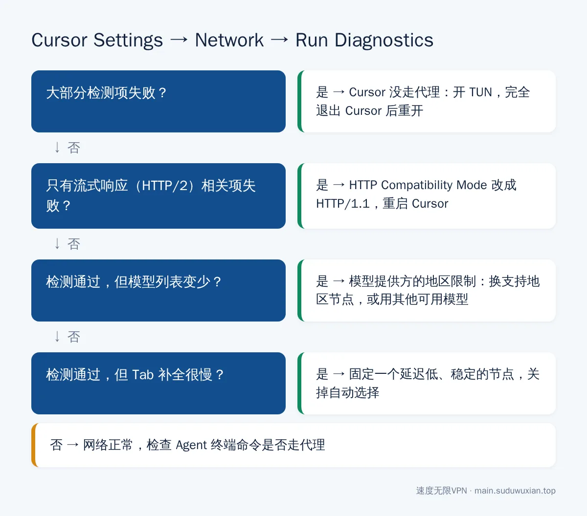
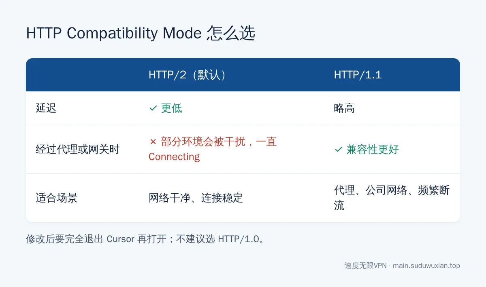

# Cursor 一直 Connecting 怎么办？登录失败、补全慢网络优化（2026）
<!-- description: Cursor 一直 Connecting、登录失败、模型列表变少、Tab 补全卡顿？用 Run Diagnostics 定位问题，改 HTTP/1.1、开 TUN 模式、放行 cursor.sh 等域名、固定低延迟节点逐个解决。 -->

作者：速度无限技术团队 ｜ 最后更新：2026-10-24

**简短回答**：先打开 Cursor Settings → Network，点 **Run Diagnostics** 看哪项失败。一直 Connecting… 最常见的原因是 Cursor 用来接收回答的 HTTP/2 流式连接被干扰，把 **HTTP Compatibility Mode 改成 HTTP/1.1** 后完全退出重开；同时开 **TUN 模式**，保证 Cursor 本体、扩展和 Agent 在终端里执行的命令都走代理。模型列表变少是模型提供方的地区限制，补全慢则要换一个延迟低且稳定的固定节点。


## 本文要点

- **先诊断**：Cursor Settings → Network → Run Diagnostics，是 Cursor [官方网络排错文档](https://cursor.com/help/troubleshooting/network)推荐的第一步。
- **一直 Connecting…**：Cursor 用 HTTP/2 传输流式回答，部分代理会干扰 HTTP/2；改成 HTTP/1.1，然后**完全退出** Cursor 再打开。
- **开 TUN 模式**：Cursor 的部分请求、扩展下载、Agent 执行的 `npm` / `pip` / `git` 命令不一定走系统代理。
- **模型变少或提示 doesn't serve your region**：部分模型提供方按地区限制，[官方说明](https://cursor.com/docs/account/regions)不可用的模型会从列表里消失。
- **补全卡顿**：Tab 补全是高频小请求，对延迟和丢包敏感，固定一个稳定的低延迟节点。

## 开始之前：用 Run Diagnostics 定位问题

1. 打开 Cursor，按 `Ctrl + Shift + J`（Mac 是 `Cmd + Shift + J`）打开 Cursor Settings，或点右上角齿轮。
2. 左侧找到 **Network**，点 **Run Diagnostics**。

**你应该看到什么**：所有检测项都通过。



*图：根据诊断结果决定先做哪一步。*

| 诊断结果 | 说明 | 去看哪一节 |
|---|---|---|
| 大部分项目失败 | Cursor 没走代理 | 第一步 |
| 只有流式响应（HTTP/2）相关项失败 | HTTP/2 被干扰 | 第二步 |
| 全部通过，但模型列表变少或报地区错误 | 出口 IP 所在地区受限 | 第四步 |
| 全部通过，但补全很慢 | 节点延迟高或不稳定 | 第五步 |

Cursor 更新很频繁，菜单名称和位置如果和本文略有不同，以你当前的版本为准（本文截至 2026 年 10 月）。

---

## 第一步：让 Cursor 的所有流量走代理（开 TUN）

Cursor 基于 VS Code，网络请求来自编辑器主进程、AI 功能、扩展和 Agent 打开的终端。只开系统代理时，其中一部分不一定走代理，于是出现"有的功能能用、有的不能用"。

最省事的是开 TUN 模式，以 Clash Verge 为例：

1. 打开"设置"，找到"虚拟网卡模式"（TUN 模式）。
2. 第一次开启会提示安装"服务模式"，点安装并在管理员权限窗口里点"是"。
3. 打开"虚拟网卡模式"开关，"系统代理"可以关掉，避免两者冲突。
4. **完全退出 Cursor**（Windows 在托盘图标里退出，Mac 按 `Cmd + Q`）再重新打开。只关窗口或 Reload Window 不够。

**规则模式下要放行的域名**：Cursor 官方文档列出的需要访问的域名包括 `*.cursor.sh`（含登录用的 `authenticate.cursor.sh`）、`*.cursor-cdn.com`、`*.cursorapi.com`（含扩展市场 `marketplace.cursorapi.com`），再加上官网 `cursor.com`。可以在覆写配置里补上：

```yaml
rules:
  - DOMAIN-SUFFIX,cursor.sh,你的代理策略组名
  - DOMAIN-SUFFIX,cursor-cdn.com,你的代理策略组名
  - DOMAIN-SUFFIX,cursorapi.com,你的代理策略组名
  - DOMAIN-SUFFIX,cursor.com,你的代理策略组名
```

**不想开 TUN 时**：可以在 Cursor 的 `settings.json` 里指定代理（[VS Code 网络设置文档](https://code.visualstudio.com/docs/setup/network)里有这两个选项的说明），端口以你的客户端为准，Clash Verge 默认是 7897：

```json
{
  "http.proxy": "http://127.0.0.1:7897",
  "http.proxySupport": "override"
}
```

这种方式只覆盖一部分请求，Agent 终端里的命令仍然不走代理，所以更推荐 TUN。TUN 的原理和常见问题见 [Claude Code、Codex 配合 Clash Meta TUN 模式](claude-code-codex-clash-meta-tun.md)。

**你应该看到什么**：再跑一次 Run Diagnostics，失败项明显减少或全部通过。

---

## 第二步：一直 Connecting… 或回答中途停住：改用 HTTP/1.1

Cursor 默认用 HTTP/2 接收 AI 的流式回答，部分代理链路和网关会干扰 HTTP/2 长连接，表现就是一直 Connecting… 或回答输出到一半停住。Cursor 官方给的办法：

1. 打开 Cursor Settings → **Network**。
2. 把 **HTTP Compatibility Mode** 改成 **HTTP/1.1**。
3. **完全退出 Cursor 后重新打开**。



*图：两种模式各有取舍，连接不稳时优先选 HTTP/1.1。*

**你应该看到什么**：聊天能正常收到回答，不再一直转。

**需要知道的代价**：HTTP/1.1 延迟会略高，但稳定性通常更好；不建议选更老的 HTTP/1.0。换了网络环境后可以再改回 HTTP/2 比较一下。

---

## 第三步：登录失败

Cursor 的登录流程是：点 Log In → 浏览器打开登录页 → 浏览器提示"打开 Cursor"→ 回到 Cursor 完成登录。中间任何一环没走代理都会失败。

1. **浏览器能不能打开 `cursor.com`**：打不开说明浏览器没走代理。
2. **浏览器登录后有没有提示"打开 Cursor"**：被拦截了就在弹窗里点允许，或回到 Cursor 再点一次登录。
3. **浏览器显示登录成功，Cursor 里仍未登录**：是 Cursor 本身没连上 `authenticate.cursor.sh` 等服务器，开 TUN 后完全退出重开。
4. **用 Google / GitHub 账号登录**：确认浏览器能正常打开对应网站。

**你应该看到什么**：Cursor 设置里显示你的账号邮箱和订阅状态。

---

## 第四步：模型列表变少，或提示 doesn't serve your region

这不是 Cursor 坏了。根据 Cursor 的[地区说明](https://cursor.com/docs/account/regions)，部分模型提供方有基于地区的限制，受限地区里这些模型**不会出现在列表里**，其他模型照常可用；有时也会直接提示 "This model provider doesn't serve your region"。

1. 访问 `https://cursor.com/cdn-cgi/trace`，看 `loc=` 后面的国家代码。
2. 是 `CN` 或 `HK` 时，换美国、日本、新加坡、台湾等节点，开 TUN 后完全退出 Cursor 重开，再看模型列表。
3. 官方给出的其他选择：继续使用列表里可用的模型，或在支持的情况下填写服务你所在地区的模型提供方的 API Key。

**你应该看到什么**：需要的模型出现在列表里并能正常对话。

---

## 第五步：Tab 补全延迟高、时有时无

Tab 补全是你每敲几个字就发一次的**高频小请求**，体验取决于往返延迟和稳定性。

1. **固定节点**：关掉"自动选择""负载均衡"，自动切换时正在进行的请求全部失败，补全就时有时无。
2. **按实际体验选节点**：测速数字只是一次握手的时间，每个候选节点用十分钟，选补全最跟手的那个。原理见[测速延迟和实际体验为什么不一样](latency-test-vs-real-experience.md)。
3. **选对协议**：网络对 UDP 不限速时，Hysteria2 在丢包较多的线路上更稳；公司或校园网 UDP 受限时用 VLESS+Reality 或 AnyTLS。详见[节点和协议怎么选](protocol-choice-guide.md)。
4. **改了 HTTP/1.1 后补全变慢**：可以改回 HTTP/2 比较一下。

---

## 第六步：Agent 执行命令时下载失败

Agent 帮你装依赖、拉代码时，会在终端里执行 `npm install`、`pip install`、`git clone` 等命令。这些是独立程序，不读取 Cursor 的代理设置，常见报错是 `ETIMEDOUT`、`ECONNRESET`、`Failed to connect to github.com`。

- **最省事**：开 TUN 模式。
- **不开 TUN 时**：在终端里临时设置代理环境变量（macOS / Linux，端口以你的客户端为准）：

```bash
export https_proxy=http://127.0.0.1:7897 http_proxy=http://127.0.0.1:7897
```

GitHub 相关问题见 [GitHub 国内访问问题汇总](github-access-china-fix.md)。

## 常见问题速查表

| 现象 | 最可能的原因 | 怎么解决 |
|---|---|---|
| 聊天一直 Connecting… | HTTP/2 流式连接被干扰，或没走代理 | 改 HTTP/1.1；开 TUN；完全退出重开 |
| Run Diagnostics 大部分失败 | Cursor 没走代理 | 开 TUN 模式，完全退出后重开 |
| 浏览器登录成功，Cursor 仍未登录 | Cursor 没连上登录服务器 | 开 TUN，完全退出重开，再点一次登录 |
| 模型列表变少 / doesn't serve your region | 出口 IP 所在地区受模型提供方限制 | 换美国、日本、新加坡、台湾节点；或用其他可用模型 |
| 补全时有时无 | 节点自动切换 | 关掉自动选择，固定节点 |
| 补全很慢 | 节点延迟高或丢包 | 按实际体验换节点；UDP 受限时别用 Hysteria2 |
| Agent 执行 npm / pip / git 超时 | 终端命令没走代理 | 开 TUN，或设置代理环境变量 |
| 扩展商店打不开、扩展装不上 | `cursorapi.com` 没走代理 | 开 TUN 或补充分流规则后重开 |

## 常见问题

**Cursor 一直 Connecting 怎么解决？**
在 Cursor Settings → Network 里把 HTTP Compatibility Mode 改成 HTTP/1.1，同时开启代理客户端的 TUN 模式，然后完全退出 Cursor 再打开。

**Cursor 的网络诊断在哪里？**
打开 Cursor Settings（`Ctrl/Cmd + Shift + J`），在 Network 页面点 Run Diagnostics，会逐项检测到 Cursor 服务器的连接。

**Cursor 为什么有些模型不见了？**
部分模型提供方有地区限制，在受限地区这些模型不会出现在列表里。换支持地区的节点后重开 Cursor，或改用列表里可用的模型。

**Cursor 需要放行哪些域名？**
官方文档列出了 `*.cursor.sh`、`*.cursor-cdn.com`、`*.cursorapi.com` 等，再加上 `cursor.com`；规则模式下让它们都走代理即可。

**Cursor 开了系统代理为什么还是不行？**
Cursor 的部分请求、扩展下载和 Agent 在终端执行的命令不一定读取系统代理，开 TUN 模式能一次覆盖所有程序。

---

## 参考资料

- Cursor 文档：[Network, proxy, and remote connections](https://cursor.com/help/troubleshooting/network)
- Cursor 文档：[Regions](https://cursor.com/docs/account/regions)
- Visual Studio Code 文档：[Network Connections in Visual Studio Code](https://code.visualstudio.com/docs/setup/network)
- Cloudflare 文档：[/cdn-cgi/ endpoint](https://developers.cloudflare.com/fundamentals/reference/cdn-cgi-endpoint/)

## 相关阅读

- [Claude Code、Codex 配合 Clash Meta TUN 模式](claude-code-codex-clash-meta-tun.md)
- [GitHub 国内访问问题汇总](github-access-china-fix.md)
- [节点和协议怎么选](protocol-choice-guide.md)
- [ChatGPT 国内使用指南](chatgpt-access-guide.md)
- [Claude 稳定访问指南](claude-access-guide.md)

---

> 速度无限：Hysteria2 / VLESS+Reality / AnyTLS 多协议节点，基础套餐 19 元/月起，[qaz.suduwuxian.top](https://qaz.suduwuxian.top)。节点公告和更新请关注 Telegram 频道：[t.me/suduwuxiantop](https://t.me/suduwuxiantop)
