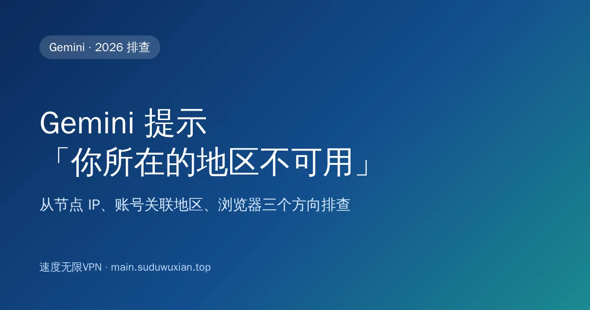
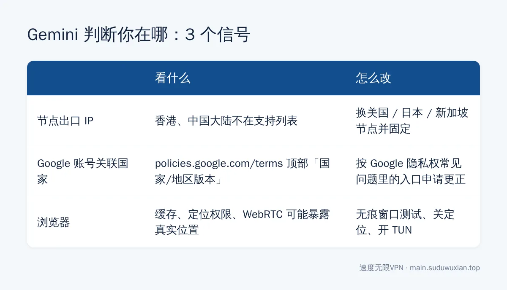
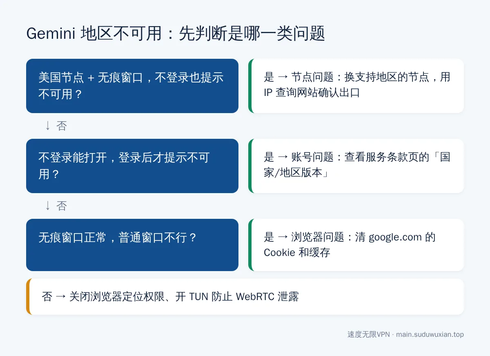

# Gemini 提示国家/地区不可用怎么办？节点、账号、浏览器 3 步排查（2026）
<!-- description: Gemini 提示在你所在的国家/地区不可用？按节点 IP、Google 账号关联国家、浏览器缓存与定位三步排查，教你查看并申请更正账号地区，附速查表。 -->

作者：速度无限技术团队 ｜ 最后更新：2026-10-24

**简短回答**：Gemini 判断你在哪，看的不只是 IP，还有 **Google 账号的关联国家**和**浏览器暴露的位置**。按顺序排查：① 换美国、日本、新加坡等支持地区的节点（不要用香港）；② 打开 `policies.google.com/terms` 看顶部的"国家/地区版本"，是中国或香港就要申请更正；③ 用无痕窗口测试，清除 Google 的 Cookie、关闭浏览器定位权限。

## 本文要点

- **节点**：Google 的 Gemini 网页版覆盖 230 多个国家和地区，但不包括中国大陆和香港；换美国、日本、新加坡、台湾节点并固定。
- **账号地区**：Google 账号有一个"关联国家/地区"，是中国或香港的话换节点也没用。
- **浏览器**：缓存、定位权限、WebRTC 可能暴露真实位置。
- **其他原因**：Family Link 管理的账号、标记为未满 18 岁的教育版账号不能用 Gemini；公司 Workspace 账号需要管理员开启。

*图：三个信号对应三个排查方向。*

## 先快速判断是哪一类问题

*图：用"不登录 / 登录 / 无痕窗口"三次测试定位问题。*

---

## 第一步：换一个支持地区的节点

### 1.1 不要用香港节点

很多机场默认节点是香港，速度快、延迟低，但 Gemini 不对香港提供服务（ChatGPT、Claude 也一样）。推荐美国节点，其次日本、新加坡、台湾。Google 官方的[可用地区说明](https://support.google.com/gemini/answer/13575153)里有完整列表。

### 1.2 确认出口 IP 真在你以为的地方

节点名写着"美国"，实际出口 IP 可能被 Google 识别成别的地方。打开 `ipinfo.io` 之类的 IP 查询网站看显示的国家，不对就换节点。为什么延迟低的节点不一定好用，可以看[测速延迟和实际体验为什么不一样](latency-test-vs-real-experience.md)。

### 1.3 关掉"自动选择"，固定节点

"自动选择""负载均衡"策略组会在不同地区的节点间来回切换，前一个请求走美国、后一个走香港，Gemini 就会时好时坏。

### 1.4 规则模式下检查 Google 策略组

Google 相关域名可能被分到单独的策略组（如"谷歌服务"），这个组里选的可能还是香港节点。在 Clash 的"代理"页面把它也切到美国节点，策略组用法见 [Clash Verge 订阅教程](clash-verge-subscription-tutorial.md)。

---

## 第二步：检查 Google 账号的关联国家/地区

这是最常被忽略的原因。

### 2.1 怎么查看

登录 Google 账号后打开 [Google 服务条款页面](https://policies.google.com/terms)，页面顶部有"国家/地区版本"（Country version）。显示**中国**或**香港**的话，用哪里的节点 Gemini 都会提示不可用。

### 2.2 为什么会是中国或香港

按 [Google 隐私权常见问题](https://policies.google.com/faq)的说明：新账号按**注册时所在的国家**关联；注册满一年的账号，按你**平时访问 Google 服务时所在的国家**关联。所以一直用香港节点上 Google，账号很可能被判定为香港。

### 2.3 怎么修改

同一份常见问题里写明：如果你认为关联的国家不对，可以联系 Google 申请更正。按页面上的入口提交，填写真实的居住情况和时间。

- 处理需要时间，结果发到邮箱；不保证一定通过。
- 长期稳定使用同一地区的节点，账号地区有时会自动更新过来。

---

## 第三步：排除浏览器的干扰

1. **用无痕窗口试一次**。无痕能用说明是缓存或 Cookie 记住了旧地区，清除 `google.com` 相关的 Cookie 和缓存。
2. **关闭浏览器定位权限**。浏览器设置 → 隐私和安全 → 网站设置 → 位置信息，把 `gemini.google.com` 和 `google.com` 设为"阻止"。
3. **防止 WebRTC 绕过代理**。最简单的办法是开启 Clash 的 TUN 模式，让浏览器所有流量都经过代理。
4. **换个浏览器交叉验证**，Chrome、Edge、Firefox 都试一下。

---

## 其他可能的原因

- **账号类型限制**：[Gemini 移动应用帮助](https://support.google.com/gemini/answer/14579026)写明，需要使用个人 Google 账号；Family Link 管理的账号、被标记为未满 18 岁的 Google Workspace 教育版账号不能使用 Gemini 应用。
- **公司或学校的 Workspace 账号**：管理员可能没开启 Gemini，换个人 Gmail 测试即可确认。
- **AI Studio 和 Gemini 是两回事**：开发者用的 Google AI Studio 和 Gemini API 可用地区列表与网页版不完全相同，排查思路一样：节点 → 账号地区 → 浏览器。
- **手机 Gemini App**：还和手机系统地区、Google Play 国家有关，参考[安卓手机安装 ChatGPT](android-chatgpt-install-china.md)里关于 Play 国家的部分。

---

## 常见问题速查表

| 现象 | 最可能的原因 | 怎么解决 |
|---|---|---|
| 不登录都提示不可用 | 节点 IP 在香港或不支持的地区 | 换美国 / 日本 / 新加坡节点，用 IP 查询网站确认 |
| 不登录能用，登录后不可用 | 账号关联国家是中国或香港 | 查看服务条款页，按常见问题入口申请更正 |
| 时好时坏 | 自动选择在不同地区间切换 | 固定节点；检查 Google 策略组 |
| 无痕窗口能用，普通窗口不行 | 缓存 / Cookie | 清除 google.com 的 Cookie 和缓存 |
| 换了节点和账号都不行 | 浏览器定位或 WebRTC 泄露 | 关闭定位权限，开 TUN |
| 公司账号不能用，个人账号能用 | Workspace 管理员没开启 | 联系管理员，或用个人账号 |

---

## 常见问题

**为什么开着代理 Google 能用，Gemini 却提示地区不可用？**
Google 搜索在香港等地区可用，但 Gemini 不支持香港和中国大陆。很多机场默认是香港节点，换成美国、日本、新加坡节点即可。

**怎么查 Google 账号的关联国家？**
登录后打开 policies.google.com/terms，页面顶部的"国家/地区版本"就是你账号当前关联的国家。

**Google 账号地区是香港，能改成美国吗？**
可以申请。按 Google 隐私权常见问题里的入口提交更正申请，处理需要几天，不保证通过；长期使用同一地区的节点，地区也可能自动更新。

**用美国节点了，Gemini 还是时好时坏怎么办？**
多半是"自动选择"策略组在不同地区的节点间切换，或 Google 被分到了另一个仍是香港节点的策略组。手动固定节点即可。

**未成年账号能用 Gemini 吗？**
Family Link 管理的账号、被标记为未满 18 岁的 Workspace 教育版账号不能使用 Gemini 应用，需要换用符合条件的个人账号。

---

## 参考资料

- Google 帮助中心：[Where you can use the Gemini web app](https://support.google.com/gemini/answer/13575153)
- Google 帮助中心：[Gemini 移动应用的使用条件](https://support.google.com/gemini/answer/14579026)
- Google：[服务条款（查看国家/地区版本）](https://policies.google.com/terms)
- Google：[隐私权常见问题（账号关联国家的判断规则）](https://policies.google.com/faq)

## 相关阅读

- [ChatGPT / Claude / Gemini 国内访问指南](chatgpt-claude-gemini-access-china.md)
- [节点和协议怎么选？](protocol-choice-guide.md)
- [国内安卓手机怎么安装 ChatGPT](android-chatgpt-install-china.md)
- [Clash Verge 订阅教程](clash-verge-subscription-tutorial.md)

---

> 速度无限：Hysteria2 / VLESS+Reality / AnyTLS 多协议节点，基础套餐 19 元/月起，[qaz.suduwuxian.top](https://qaz.suduwuxian.top)。节点公告和更新请关注 Telegram 频道：[t.me/suduwuxiantop](https://t.me/suduwuxiantop)
