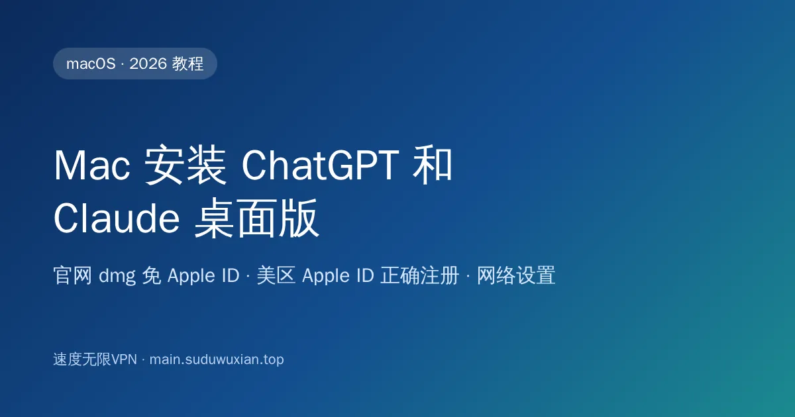
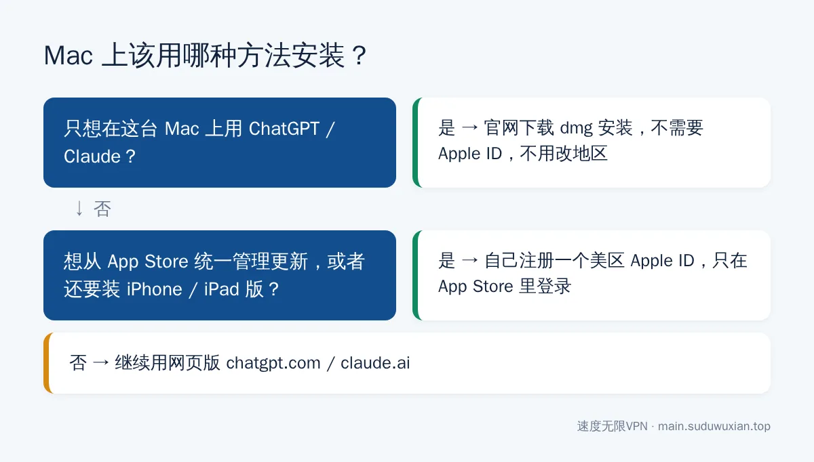
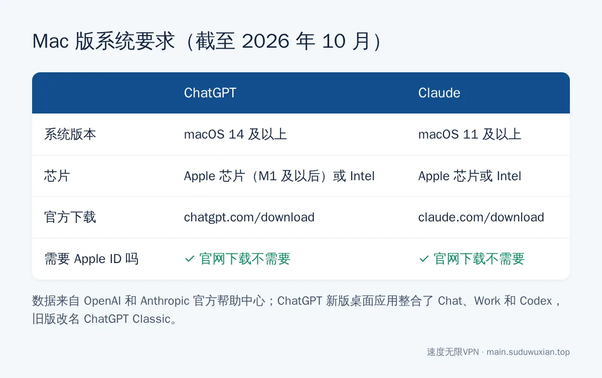

# Mac 安装 ChatGPT 和 Claude 桌面版：官网下载免 Apple ID（2026）
<!-- description: Mac 装 ChatGPT 和 Claude 不需要美区 Apple ID：官网 dmg 直接安装，ChatGPT 需 macOS 14（Intel 也支持），Claude 需 macOS 11，附美区 Apple ID 正确注册方法。 -->

作者：速度无限技术团队 ｜ 最后更新：2026-10-24

**简短回答**：Mac 上装 ChatGPT 和 Claude **不需要美区 Apple ID**——两家都提供官网 `.dmg` 安装包：ChatGPT 从 [chatgpt.com/download](https://chatgpt.com/download/) 下载（需要 macOS 14 及以上，Apple 芯片和 Intel 都支持），Claude 从 [claude.com/download](https://claude.com/download) 下载（macOS 11 及以上）。美区 Apple ID 主要是给 iPhone、iPad 从 App Store 安装用的，要用就自己注册，千万别用别人共享的账号。

## 本文要点

- **首选官网下载**：两家都有官方 `.dmg`，不需要 Apple ID，不用改地区。
- **系统要求**：ChatGPT 需要 macOS 14 及以上；Claude 需要 macOS 11 及以上；两者都支持 Apple 芯片和 Intel 芯片。
- **ChatGPT 新旧版**：2026 年 7 月起，新版 ChatGPT 桌面应用整合了 Chat、Work 和 Codex，原来的 Mac 应用改名 **ChatGPT Classic**，仍可继续使用。
- **美区 Apple ID**：主要用于 iPhone / iPad；自己注册，付款方式选"无"，只在 App Store 里登录。
- **网络**：节点用美国、日本、新加坡等，**不要用香港**；建议开启 TUN 模式。

*图：大多数人只需要官网下载这一条路。*

---

## 第一步：先把网络准备好

### 1.1 节点选择

OpenAI 和 Anthropic 支持的地区都**不包括中国大陆和香港**（见文末参考资料里的官方列表）。推荐美国节点，其次日本、新加坡、台湾，同一个账号尽量固定用同一个地区——频繁切换地区是账号被风控的常见原因，详见[用了 VPN 还是被 Claude 封号？](claude-account-ban-vpn-myth.md)

### 1.2 Mac 上的代理客户端

Mac 上常用 Clash Verge 的 macOS 版或其他 Mihomo 内核客户端，导入订阅的方法和 Windows 一样，见 [Clash Verge 订阅教程](clash-verge-subscription-tutorial.md)。建议打开 **TUN 模式**（第一次开启需要输入电脑密码授权）。

原生应用大多会读取系统代理，只开系统代理多数时候能用；但应用里的部分组件、命令行工具和 Claude 的 MCP 工具不一定读取，开 TUN 能避免"有的功能能用、有的不能用"。命令行工具的情况详见 [Claude Code、Codex 装完打不开？](claude-code-codex-clash-meta-tun.md)

---

## 方法一：官网下载（推荐）

*图：截至 2026 年 10 月的官方系统要求。*

### ChatGPT Mac 版

1. 打开 OpenAI 官方下载页：`https://chatgpt.com/download/`，页面会根据你的芯片提供对应安装包。
2. 下载得到 `.dmg` 文件，双击打开，把 ChatGPT 拖进"应用程序"文件夹。
3. 从启动台或"应用程序"打开 ChatGPT，登录账号。

**系统要求**：[OpenAI 帮助中心](https://help.openai.com/en/articles/9395554-what-are-the-system-requirements-for-the-chatgpt-macos-app)写明需要 **macOS 14 及以上**，Apple 芯片（M1 及以后）或 Intel 处理器都可以，并表示不会为更老的系统发布版本。系统低于 macOS 14 的话，先在 系统设置 → 通用 → 软件更新 里升级；升级不了就用网页版 chatgpt.com。

**新版还是 Classic**：新版 ChatGPT 桌面应用整合了 Chat、Work 和 Codex；原来的应用改名 ChatGPT Classic，继续维护，不强制迁移。区别见 [OpenAI 迁移说明](https://help.openai.com/en/articles/20001276-moving-to-the-new-chatgpt-desktop-app)。

### Claude Mac 版

1. 打开 Claude 官网下载页：`https://claude.com/download`，选择 macOS。
2. 把 `.dmg` 里的 Claude 拖进"应用程序"文件夹，打开后登录。

[官方安装说明](https://support.claude.com/en/articles/10065433-installing-claude-desktop)要求 **macOS 11（Big Sur）及以上**。

### 第一次打开提示"无法验证开发者"怎么办

官网下载的正版安装包都经过苹果公证，正常情况下双击就能打开。如果被拦截，先确认文件确实来自官网，然后打开 **系统设置 → 隐私与安全性**，在下方找到被拦截的应用，点"仍要打开"（苹果官方说明：[安全地打开 Mac 上的 App](https://support.apple.com/102445)）。

> ⚠️ 如果安装包要求你关闭 Gatekeeper、在终端执行 `sudo spctl --master-disable` 之类的命令才能打开，它多半不是官方版本，直接删掉。

---

## 方法二：美区 Apple ID（主要给 iPhone / iPad 用）

ChatGPT 和 Claude 的 iPhone、iPad 版在中国区 App Store 搜不到，需要一个非中国区的 Apple ID。

### 2.1 自己注册一个美区 Apple ID

1. 打开 `https://appleid.apple.com`，点"创建你的 Apple 账户"。
2. **国家或地区选"美国"**，用一个**没注册过 Apple ID 的邮箱**（建议 Gmail 或 Outlook）。
3. 手机号可以填自己的中国手机号（+86）接收验证码。
4. 第一次在 App Store 登录时会要求补全账单信息：**付款方式选"无"（None）**，账单地址填一个美国地址。苹果的说明见[在没有付款方式的情况下创建 Apple 账户](https://support.apple.com/HT204034)。

**几点注意**：

- 注册和第一次登录时保持美国节点、开启 TUN。
- 看不到"无"选项时，通常是网络或地区判断问题，换个美国节点重试；苹果也说明某些情况下可能仍需要付款方式。
- **只在 App Store 里登录美区账号**，不要在 系统设置 顶部的 iCloud 里登录，那会把照片、通讯录等 iCloud 数据和这个账号绑在一起。

### 2.2 搜索安装

在 App Store 搜索 ChatGPT 或 Claude，**认准开发者 OpenAI 或 Anthropic**。装完可以切回中国区 Apple ID，已装的应用照常用，更新时再临时切回美区。

> ⚠️ 不要用网上的"共享美区 Apple ID"。这类账号经常被改密码、开双重认证，别人一旦在你设备的 iCloud 里登录，可以远程锁定你的设备。

---

## 常见问题速查表

| 现象 | 最可能的原因 | 怎么解决 |
|---|---|---|
| App Store 搜不到 ChatGPT / Claude | Apple ID 是中国区 | Mac 用官网下载；iPhone 用美区 Apple ID |
| ChatGPT 安装后提示需要更新系统 | macOS 低于 14 | 升级 macOS；升级不了用网页版 |
| 提示无法验证开发者 | Gatekeeper 拦截 | 系统设置 → 隐私与安全性 → 仍要打开 |
| 打开后白屏、一直转圈 | 应用没连上网络 | 开 TUN，`Command + Q` 完全退出后重开 |
| 提示地区不支持 / Unsupported country | 节点在香港或不支持的地区 | 换美国、日本、新加坡节点 |
| 美区 Apple ID 没有"无"付款选项 | 网络或地区判断异常 | 换美国节点；到 appleid.apple.com 网页补全信息 |

---

## 常见问题

**Mac 装 ChatGPT 一定要美区 Apple ID 吗？**
不需要。ChatGPT 和 Claude 都可以从官网下载 dmg 安装包，不用登录任何 Apple ID，也不用改地区。

**Intel 芯片的 Mac 能用 ChatGPT 桌面版吗？**
能。OpenAI 官方要求是 macOS 14 及以上，Apple 芯片（M1 及以后）和 Intel 处理器都支持。系统低于 macOS 14 才装不了。

**ChatGPT 和 ChatGPT Classic 有什么区别？**
新版 ChatGPT 桌面应用整合了 Chat、Work 和 Codex，新功能只在新版上线；ChatGPT Classic 是原来的应用，仍在维护，可以继续用。

**Claude Mac 版的最低系统要求是什么？**
macOS 11（Big Sur）及以上，从 claude.com/download 下载。

**可以用网上共享的美区 Apple ID 吗？**
不建议。共享账号随时可能被改密码，在 iCloud 登录还可能导致设备被远程锁定，自己注册一个只要十分钟。

---

## 参考资料

- OpenAI 帮助中心：[ChatGPT macOS 应用系统要求](https://help.openai.com/en/articles/9395554-what-are-the-system-requirements-for-the-chatgpt-macos-app)
- OpenAI 帮助中心：[Downloading the ChatGPT macOS app](https://help.openai.com/en/articles/9275200-downloading-the-chatgpt-macos-app)
- OpenAI 帮助中心：[Moving to the new ChatGPT desktop app](https://help.openai.com/en/articles/20001276-moving-to-the-new-chatgpt-desktop-app)
- Claude 帮助中心：[Installing Claude Desktop](https://support.claude.com/en/articles/10065433-installing-claude-desktop)
- Apple 支持：[安全地打开 Mac 上的 App](https://support.apple.com/102445)
- Apple 支持：[在没有付款方式的情况下创建或使用 Apple 账户](https://support.apple.com/HT204034)
- OpenAI：[支持的国家和地区](https://help.openai.com/en/articles/7947663-chatgpt-supported-countries-and-territories) ｜ Anthropic：[Supported countries & regions](https://www.anthropic.com/supported-countries)

## 相关阅读

- [国内 Windows 电脑怎么从微软商店安装 ChatGPT](chatgpt-windows-microsoft-store-install-china.md)
- [国内 Windows 电脑怎么安装 Claude 桌面版](claude-windows-desktop-install-china.md)
- [ChatGPT / Claude / Gemini 国内访问指南](chatgpt-claude-gemini-access-china.md)
- [用了 VPN 还是被 Claude 封号？](claude-account-ban-vpn-myth.md)

---

> 速度无限：Hysteria2 / VLESS+Reality / AnyTLS 多协议节点，基础套餐 19 元/月起，[qaz.suduwuxian.top](https://qaz.suduwuxian.top)。节点公告和更新请关注 Telegram 频道：[t.me/suduwuxiantop](https://t.me/suduwuxiantop)
