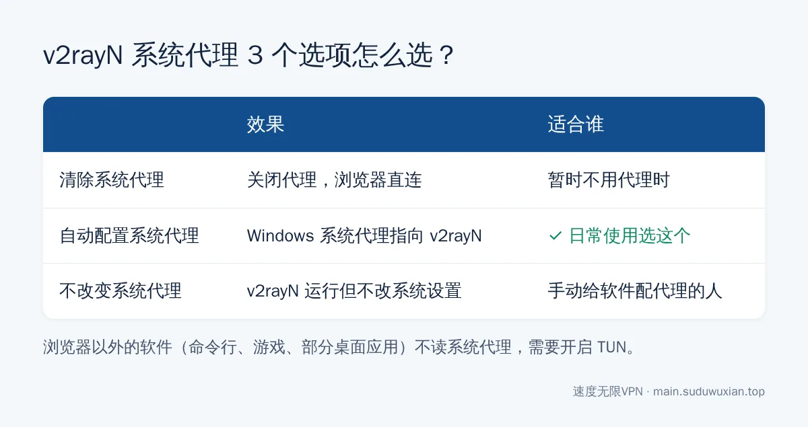

# v2rayN 怎么用？新手订阅教程：导入订阅、选节点、开代理（2026）
<!-- description: v2rayN 新手教程：下载官方便携版、导入通用订阅、测速选节点、开启系统代理、设置绕过大陆路由和 TUN 模式，附节点超时、订阅为空等常见问题。 -->

作者：速度无限技术团队 ｜ 最后更新：2026-10-24

**简短回答**：从 GitHub 官方仓库 [2dust/v2rayN](https://github.com/2dust/v2rayN/releases) 下载 `v2rayN-windows-64.zip`，解压到没有中文和空格的路径，打开 `v2rayN.exe` → 订阅分组 → 订阅分组设置 → 添加机场的**通用订阅链接** → 更新订阅 → 测速后双击选一个节点 → 底部"系统代理"选**自动配置系统代理**，就能上网了。国内网站变慢就把"路由"切到"绕过大陆"。

## 本文要点

- **下载**：只从 GitHub 官方 Releases 下载。现在的 Windows 版都是独立运行版，**不用另装 .NET**，旧教程里的 `SelfContained`、`With-Core` 压缩包已经不再提供。
- **解压位置**：路径里不要有中文和空格，比如 `D:\v2rayN`。
- **订阅格式**：v2rayN 用"通用订阅 / V2Ray 订阅"，**不要填 Clash 专用订阅**。
- **能上网的关键两步**：双击选中一个节点，再把"系统代理"设成"自动配置系统代理"。
- **新协议**：Hysteria2、AnyTLS 等节点连不上时，先更新 v2rayN 和内核，再试着切换节点的核心类型。

*图：7 步流程一图看懂，下面逐步展开。*

---

## 第一步：下载 v2rayN

1. 打开 v2rayN 官方发布页：`https://github.com/2dust/v2rayN/releases`
2. 找到最上面标着 **Latest** 的最新正式版，展开 **Assets** 文件列表。
3. 普通 Windows 电脑下载 **`v2rayN-windows-64.zip`**；想用新界面也可以选 `v2rayN-windows-64-desktop.zip`（Avalonia 界面）。骁龙 ARM 笔记本选带 `arm64` 的包。

各个文件分别是什么，官方 Wiki 的 [Release files introduction](https://github.com/2dust/v2rayN/wiki/Release-files-introduction) 写得很清楚：Windows 包是便携版，解压即用，自带 Xray 和 mihomo 内核，其他内核需要时再放进 `bin` 目录。

> ⚠️ 不要从"v2rayN 中文版""汉化版"下载站下载，官方版本本身就是中文界面。

**GitHub 打不开怎么办**：GitHub 在国内经常打不开或很慢，先看 [GitHub 国内访问修复](github-access-china-fix.md)，或者让机场客服提供官方安装包。

---

## 第二步：解压并打开

1. 新建文件夹，比如 `D:\v2rayN`。**路径里不要有中文、空格**，也不要放在桌面或"下载"文件夹。
2. 把压缩包解压到这个文件夹，双击 **`v2rayN.exe`**。

**你应该看到什么**：上方是空的服务器列表，下方是日志区域，右下角托盘出现 v2rayN 图标。

**如果打不开**：

- 被杀毒软件删除或拦截 → 代理软件常被误报，把 v2rayN 文件夹加入白名单；
- Windows 提示"已保护你的电脑" → 点"更多信息" → "仍要运行"；
- 用的还是很老的版本 → 删掉重新下载最新版。

---

## 第三步：导入订阅

### 3.1 复制订阅链接

登录机场后台找到"订阅链接"或"一键订阅"，**选"通用订阅""V2Ray 订阅"或"v2rayN"那一项**复制。不会挑机场的话，先看[机场怎么选？6 个维度帮你避开新手坑](airport-selection-guide.md)。

> 不要选"Clash 订阅"。Clash 订阅返回的是 YAML 配置文件，v2rayN 识别不了，会出现节点为空或乱码。

### 3.2 添加订阅

1. 菜单栏 **订阅分组 → 订阅分组设置**。
2. 点 **添加**。
3. **备注**随便填，**可选地址（url）**粘贴订阅链接。
4. 点 **确定**，关闭窗口。

### 3.3 更新订阅

菜单栏 **订阅分组 → 更新全部订阅（不通过代理）**。

**你应该看到什么**：日志显示更新成功，服务器列表出现一串节点。

**如果没有节点**：检查链接是否完整、有没有多余空格；确认选的是通用订阅；检查套餐是否到期、流量是否用完；订阅地址本身被屏蔽时，先手动导入一个节点连上，再用"更新全部订阅（通过代理）"。

---

## 第四步：测速并选择节点

1. 服务器列表里 `Ctrl + A` 全选，右键 **测试服务器真连接延迟**（`Ctrl + R`）。
2. 每个节点后面会显示延迟（毫秒），`-1` 或超时表示连不上。
3. 选一个延迟合适的节点，**双击**（或选中后回车）设为活动节点。

> 延迟最低不一定最好用。延迟只代表"握手快不快"，看视频、下载是否流畅还和带宽、线路有关，详见[为什么测速延迟和实际体验不一样](latency-test-vs-real-experience.md)。

---

## 第五步：开启系统代理

**选好节点不等于浏览器已经在用代理。** 在窗口底部（或右键托盘图标）找到 **系统代理**，选 **自动配置系统代理**。

*图：日常使用选"自动配置系统代理"。*

**你应该看到什么**：托盘图标颜色变化；浏览器能打开 `google.com`。

---

## 第六步：路由选"绕过大陆"

默认可能所有网站都走代理，访问淘宝、B 站反而变慢还费流量。窗口底部 **路由** 选 **绕过大陆**：国内网站直连，国外网站走代理。

---

## 第七步（可选）：开启 TUN 模式

系统代理只对会读取它的软件生效（比如浏览器）。Claude Code、Codex、游戏和部分桌面软件不读系统代理，需要 TUN 模式接管全部流量，原因见 [Claude Code / Codex 配合 TUN 模式](claude-code-codex-clash-meta-tun.md)。

在窗口底部打开 **启用 Tun**。TUN 需要管理员权限，提示权限不足时，退出 v2rayN 后**右键 `v2rayN.exe` → 以管理员身份运行**再打开。

---

## 第八步：开机自启和更新

- **开机自启**：设置 → 参数设置 → 勾选"开机自动启动"。
- **更新 v2rayN 和内核**：菜单 → 检查更新，可以分别更新 v2rayN 本身和各个内核。
- **新协议连不上**：Hysteria2、VLESS+Reality、AnyTLS 等新协议需要较新的内核。更新后仍连不上，在节点编辑窗口把**核心类型**切换成 mihomo 或 sing-box 试试（sing-box 不在默认包里时，按 Wiki 说明下载后放进 `bin` 目录）。协议之间的区别见[节点和协议怎么选](protocol-choice-guide.md)。
- **定期更新订阅**：机场换节点后需要重新"更新全部订阅"，也可以在订阅分组设置里设自动更新间隔。

---

## 常见问题速查表

| 现象 | 最可能的原因 | 怎么解决 |
|---|---|---|
| 双击 v2rayN.exe 没反应或报错 | 被杀毒拦截、版本太旧、路径有中文 | 加白名单；下载最新版；换英文路径 |
| 更新订阅后没有节点 | 订阅格式选错 / 链接不完整 / 套餐到期 | 换通用订阅链接；检查套餐状态 |
| 节点测速全部 -1 或超时 | 电脑时间不准、内核太旧、网络限制 | 校准时间；更新内核；参考[节点全部超时怎么办](node-timeout-troubleshooting.md) |
| 节点有延迟，浏览器打不开网页 | 没开系统代理 | 系统代理选"自动配置系统代理" |
| 国外网站能开，国内网站变慢 | 路由是全局 | 路由选"绕过大陆" |
| 浏览器能用，命令行 / 部分软件不能用 | 这些软件不读系统代理 | 开启 TUN |
| 关掉 v2rayN 后电脑上不了网 | 系统代理没被清除 | 重新打开 v2rayN 选"清除系统代理"后再退出 |
| 只有 Hysteria2 节点连不上 | 当前网络限制 UDP，或内核太旧 | 换 VLESS+Reality / AnyTLS 节点；更新内核 |

---

## 常见问题

**v2rayN 下载哪个文件？**
普通 64 位 Windows 下载 `v2rayN-windows-64.zip`，ARM 笔记本下载带 arm64 的包。现在的 Windows 版解压即用，不需要另外安装 .NET。

**v2rayN 能导入 Clash 订阅吗？**
不建议。v2rayN 用的是通用订阅（V2Ray 订阅）格式，Clash 订阅返回 YAML 配置文件，导入后常出现节点为空或乱码。在机场后台复制"通用订阅"链接即可。

**v2rayN 选了节点为什么还是上不了网？**
选节点只是指定了用哪条线路，还要在底部"系统代理"里选"自动配置系统代理"，浏览器才会走代理。

**v2rayN 支持 Hysteria2 吗？**
支持，但需要较新版本的 v2rayN 和内核。连不上时先更新，再在节点编辑里把核心类型切换成 mihomo 或 sing-box 试试。

**v2rayN 和 Clash Verge 哪个好？**
都能用。v2rayN 界面简单、上手快；Clash Verge 基于 Mihomo 内核，分流规则和策略组更灵活。机场提供哪种订阅、你习惯哪种界面就用哪个。

---

## 参考资料

- GitHub：[2dust/v2rayN Releases（官方下载）](https://github.com/2dust/v2rayN/releases)
- GitHub Wiki：[v2rayN Release files introduction（各安装包说明）](https://github.com/2dust/v2rayN/wiki/Release-files-introduction)
- GitHub：[2dust/v2rayN 项目主页](https://github.com/2dust/v2rayN)

## 相关阅读

- [Clash Verge 订阅怎么导入？从获取链接到 TUN 模式全教程](clash-verge-subscription-tutorial.md)
- [节点全部超时怎么办？8 步排查法](node-timeout-troubleshooting.md)
- [节点和协议怎么选？](protocol-choice-guide.md)
- [为什么测速显示的延迟数字，跟实际用起来的感觉不一样](latency-test-vs-real-experience.md)
- [GitHub 国内访问修复](github-access-china-fix.md)

---

> 速度无限：Hysteria2 / VLESS+Reality / AnyTLS 多协议节点，基础套餐 19 元/月起，[qaz.suduwuxian.top](https://qaz.suduwuxian.top)。节点公告和更新请关注 Telegram 频道：[t.me/suduwuxiantop](https://t.me/suduwuxiantop)
