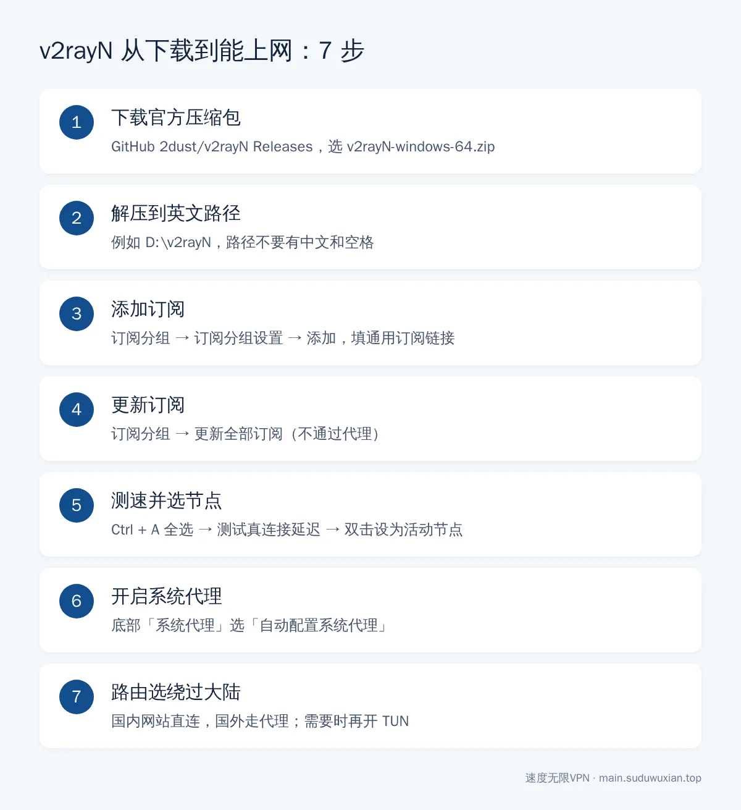
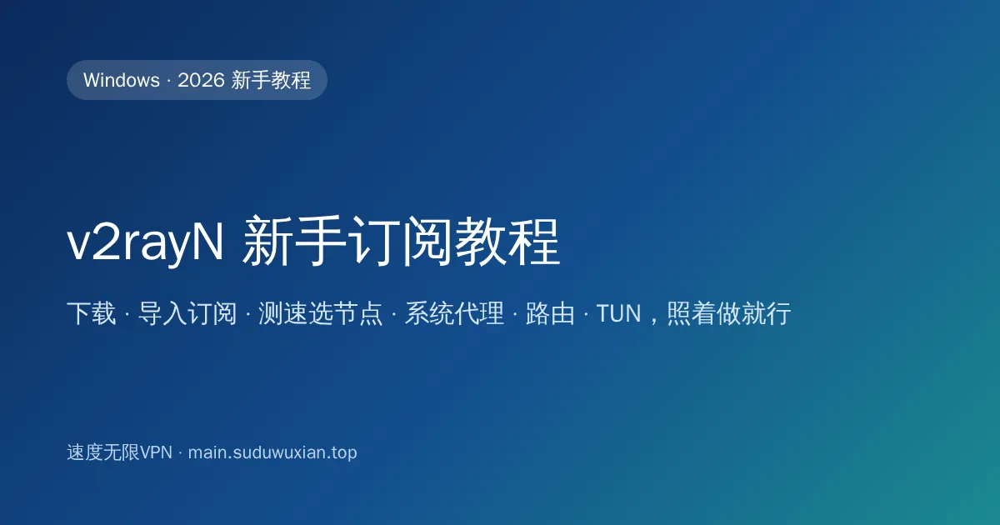

# v2rayN 怎么用？新手订阅教程：导入订阅、选节点、开代理（2026）
<!-- description: v2rayN 新手教程：下载官方便携版、导入通用订阅、测速选节点、开启系统代理、设置绕过大陆路由和 TUN 模式，附节点超时、订阅为空等常见问题。 -->

作者：速度无限技术团队 ｜ 最后更新：2026-10-24

**简短回答**：从 GitHub 官方仓库 [2dust/v2rayN](https://github.com/2dust/v2rayN/releases) 下载 `v2rayN-windows-64.zip`，解压到没有中文和空格的路径，打开 `v2rayN.exe` → 订阅分组 → 订阅分组设置 → 添加机场的**通用订阅链接** → 更新订阅 → 测速后双击选一个节点 → 底部"系统代理"选**自动配置系统代理**，就能上网了。国内网站变慢就把"路由"切到"绕过大陆"。

## 本文要点

- **下载**：只从 GitHub 官方 Releases 下载。现在的 Windows 版都是独立运行版，**不用另装 .NET**，旧教程里的 `SelfContained`、`With-Core` 压缩包已经不再提供。
- **解压位置**：路径里不要有中文和空格，比如 `D:\v2rayN`。
- **订阅格式**：v2rayN 用"通用订阅 / V2Ray 订阅"，**不要填 Clash 专用订阅**。
- **能上网的关键两步**：双击选中一个节点，再把"系统代理"设成"自动配置系统代理"。
- **新协议**：Hysteria2、AnyTLS 等节点连不上时，先更新 v2rayN 和内核，再试着切换节点的核心类型。

*图：7 步流程一图看懂，下面逐步展开。*

## 常见问题速查表

| 现象 | 最可能的原因 | 怎么解决 |
|---|---|---|
| 双击 v2rayN.exe 没反应或报错 | 被杀毒拦截、版本太旧、路径有中文 | 加白名单；下载最新版；换英文路径 |
| 更新订阅后没有节点 | 订阅格式选错 / 链接不完整 / 套餐到期 | 换通用订阅链接；检查套餐状态 |
| 节点测速全部 -1 或超时 | 电脑时间不准、内核太旧、网络限制 | 校准时间；更新内核；参考[节点全部超时怎么办](node-timeout-troubleshooting.md) |
| 节点有延迟，浏览器打不开网页 | 没开系统代理 | 系统代理选"自动配置系统代理" |
| 国外网站能开，国内网站变慢 | 路由是全局 | 路由选"绕过大陆" |
| 浏览器能用，命令行 / 部分软件不能用 | 这些软件不读系统代理 | 开启 TUN |
| 关掉 v2rayN 后电脑上不了网 | 系统代理没被清除 | 重新打开 v2rayN 选"清除系统代理"后再退出 |
| 只有 Hysteria2 节点连不上 | 当前网络限制 UDP，或内核太旧 | 换 VLESS+Reality / AnyTLS 节点；更新内核 |

> 📖 **完整内容请阅读原文**：[v2rayN 怎么用？新手订阅教程：导入订阅、选节点、开代理（2026）](https://main.suduwuxian.top/v2rayn-subscription-beginner-tutorial/)

原文包含分步骤操作说明、示意图、常见问题解答和官方参考资料。

---

> 速度无限：Hysteria2 / VLESS+Reality / AnyTLS 多协议节点，基础套餐 19 元/月起，[qaz.suduwuxian.top](https://qaz.suduwuxian.top)。节点公告和更新请关注 Telegram 频道：[t.me/suduwuxiantop](https://t.me/suduwuxiantop)
